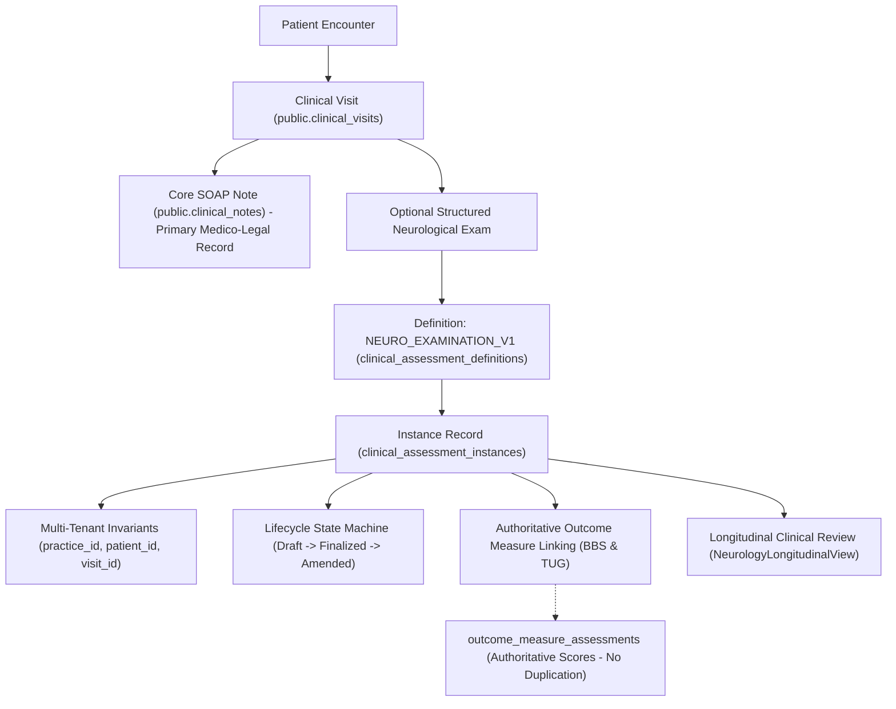

# PHYSENRA — NEUROLOGY STRUCTURED CLINICAL MODULE V1 REPORT

## 1. Executive Summary

This report documents the implementation and verification of the **Neurology Structured Clinical Module V1** for the Physenra Physiotherapy EMR and Practice Management Platform.

### Key Outcomes:
- **Architectural Preservation:** The specialty-neutral clinical assessment foundation (`clinical_assessment_definitions` and `clinical_assessment_instances`) introduced in the previous phase was 100% preserved. Zero competing tables (`neurology_assessments`, `neurology_visits`, etc.) were introduced.
- **Scope Implemented:** Established a comprehensive, structured neurological examination (`NEURO_EXAMINATION_V1`, version 1) covering all 10 clinical domains:
  1. General Neurological Observation (Alertness, Communication/Cognition, Presentation, Precautions)
  2. Upper Limb Tone (Modified Ashworth Scale, Bilateral Biceps & Wrist Flexors)
  3. Lower Limb Tone (Modified Ashworth Scale, Bilateral Quadriceps & Gastrocnemius)
  4. Deep Tendon Reflexes (Bilateral Biceps & Patellar: 0 to 4+, NT)
  5. Clonus Observation (Bilateral Ankle Clonus: Absent, Unsustained, Sustained, NT)
  6. Sensory Examination (Light Touch, Pin-prick, Proprioception, Symmetry, Body Regions)
  7. Coordination & Movement Accuracy (Finger-to-Nose, Heel-to-Shin, Rapid Alternating Movements)
  8. Voluntary Motor Control (Selective vs Synergistic Mass Patterns)
  9. Balance Integration (Authoritative BBS and TUG outcomes linked without duplicating scores)
  10. Gait & Locomotion (Assistance Levels, Gait Patterns, Assistive Devices, Stairs)
  11. Functional Mobility (Bed Mobility, Sit-to-Stand, Functional Transfers, Wheelchairs)
  12. Observational Clinical Summary & Practitioner Notes
- **Clinician-Facing Workflow:** Delivered responsive, tablet-friendly UI components (`NeurologyAssessmentForm.tsx` and `NeurologyLongitudinalView.tsx`) integrated directly into `ClinicalVisitDetailPage.tsx`.
- **SOAP Invariant Maintained:** The core medico-legal SOAP note (`public.clinical_notes`) remains the primary, independent record. Neurological examination is an optional structured clinical extension.
- **Safety Invariant:** Pure observational documentation only. Zero automated diagnosis, prognosis, AI interpretation, or impairment classification.
- **Intentional Deferrals:** Complex motor recovery scales (Fugl-Meyer), timed walk tests (10MWT), functional ambulation categories (FAC), Barthel Index, and automated diagnostic decision support were intentionally excluded and deferred to future roadmap phases.
- **Verification Status:**
  - Dedicated Neurology V1 Suite: **57 / 57 PASS**
  - Specialty Architecture Suite: **43 / 43 PASS**
  - Full Regression Suite: **1,873 / 1,873 PASS** (42 suites)
  - TypeScript & Vite Production Build: **0 Errors / Clean PASS**
  - Security & Secrets Scan: **0 Detected (100% Clean)**
  - Remote Production Database: **NOT MODIFIED**
  - Netlify / GitHub: **NOT DEPLOYED / NOT PUSHED**
  - Local Git Commit: `cdb3dfb`

---

## 2. Before Neurology V1

Prior to this phase, Physenra had completed the specialty-neutral assessment architecture with a foundational representative screen:
- **`NEURO_MOTOR_SPASTICITY_SCREEN` (v1)**: Seeded as a baseline definition with basic Modified Ashworth Scale fields, deep tendon reflexes, and ankle clonus.
- **Clinical Gaps Prior to V1:**
  - No structured fields for alertness, communication/cognitive observations, or neurological precautions.
  - Sensation and proprioception were not discretely recorded in structured format.
  - Cerebellar and motor coordination (dysmetria, dysdiadochokinesia) lacked structured capture.
  - Sitting/standing balance observations were not integrated with the existing Berg Balance Scale (BBS) and Timed Up and Go (TUG) outcome measures.
  - Gait patterns, assistive devices, and stair mobility lacked structured neurological documentation.
  - Everyday functional transfers (bed mobility, sit-to-stand, wheelchair propulsion) were documented only in free text.
  - No dedicated tablet-friendly neurological input interface or longitudinal review matrix existed.

---

## 3. Neurology V1 Architecture

The module utilizes Physenra's unified clinical encounter hierarchy. A patient encounter proceeds through the clinical visit, records the authoritative SOAP note, and optionally captures the structured neurological examination.

---

## 4. Clinical Domains Implemented

| Domain | Implemented Fields & Modalities | Input Controls | Controlled Values / Rules |
|---|---|---|---|
| **1. General Neurological Observation** | Alertness & Participation, Communication & Cognition, General Presentation, Precautions & Risks | Touch Pills, Selects, Textarea | Alert & Fully Participative, Requires Prompting, Lethargic, Minimally Responsive, NT |
| **2. Upper Extremity Tone** | Bilateral Biceps & Wrist Flexors | Bilateral Selects | Modified Ashworth Scale: `0`, `1`, `1+`, `2`, `3`, `4`, `NT` |
| **3. Lower Extremity Tone** | Bilateral Quadriceps & Gastrocnemius / Soleus | Bilateral Selects | Modified Ashworth Scale: `0`, `1`, `1+`, `2`, `3`, `4`, `NT` |
| **4. Deep Tendon Reflexes** | Bilateral Biceps & Patellar Reflexes | Bilateral Selects | `0`, `1+`, `2+`, `3+`, `4+`, `NT` |
| **5. Clonus Observation** | Bilateral Ankle Clonus | Bilateral Selects | `Absent`, `Unsustained (<5 beats)`, `Sustained (>=5 beats)`, `NT` |
| **6. Sensory Examination** | Light Touch, Pin-prick Pain, Proprioception / Joint Position, Sensory Symmetry, Body Regions | Selects & Textarea | Intact Bilaterally, Impaired Left/Right, Absent, Symmetrical, Asymmetrical, NT |
| **7. Coordination** | Finger-to-Nose (Upper), Heel-to-Shin (Lower), Rapid Alternating Movements (Dysdiadochokinesia) | Selects & Textarea | Smooth & Accurate, Mild Dysmetria, Marked Decomposition, Ataxic, NT |
| **8. Motor Control** | Selective Motor Control, Dominant Synergies, Functional Activation | Selects & Textarea | Isolated Selective Movement, Synergistic Dominant, Trace Voluntary, Flaccid, NT |
| **9. Balance Integration** | Sitting Balance, Static Standing Balance, BBS Reference Link, TUG Reference Link | Selects & Outcome Previews | Independent, Requires Assistance, Unstable, Authoritative BBS/TUG Reference IDs |
| **10. Gait & Locomotion** | Assistance Level, Gait Pattern, Assistive Device, Stair Mobility, Cadence Notes | Selects & Textarea | Independent, Standby Assist, Contact Guard, Cane, Walker, Wheelchair, Circumducting, Ataxic, NT |
| **11. Functional Mobility** | Bed Mobility, Sit-to-Stand, Functional Transfers, Wheelchair Mobility | Selects & Textarea | Independent, Minimal/Moderate/Max Assist, Pivot Board, Mechanical Lift, NT |
| **12. Clinical Summary** | Findings Synthesis & Functional Impact, Clinician Notes | Textarea | Free-text observational synthesis without automated diagnosis/prognosis |

---

## 5. Database Changes

A dedicated, non-destructive migration was created: `supabase/migrations/20261003020000_neurology_v1.sql`.

| Object | Change | Purpose | RLS | Backward Compatible |
|---|---|---|---|---|
| `clinical_assessment_definitions` | Seeded record `code = 'NEURO_EXAMINATION_V1'` (version 1, system definition) | Defines the full 10-domain schema, validation constraints, and display metadata for comprehensive neurological examinations | Inherited: authenticated users can read system definitions; modifications restricted | YES: `NEURO_MOTOR_SPASTICITY_SCREEN` remains active and unmutated |
| `clinical_assessment_instances` | None (reused existing table) | Stores instances of `NEURO_EXAMINATION_V1` with composite foreign keys | Inherited: Practice isolation & clinical role authorization enforced | YES: Zero schema drift |
| `practice_clinical_assessment_counters` | None (reused existing table) | Sequential identifier generator (`ASM-XXXXXX`) | Inherited | YES |

---

## 6. Validation

Validation is enforced across multiple boundaries:
1. **Schema-Level Definition:** Every field has explicit types (`select`, `textarea`, `text`), allowed option arrays, and required flags specified in `schema_definition` and `validation_rules`.
2. **Service Validation (`clinicalAssessmentService.validatePayload`):**
   - Validates that the payload is a non-null object.
   - Rejects any executable code tokens: `<script\b`, `\beval\s*\(`, `javascript:`, `\bon\w+\s*=`.
   - Validates presence of all required fields.
   - Enforces option strictness: any option not in the allowed list is rejected with a descriptive error.
   - Validates numeric boundaries where applicable.
3. **Database Guard Triggers (`trg_guard_assessment_invariants`):**
   - Blocks alteration of `practice_id`, `patient_id`, `clinical_visit_id`, and `definition_id`.
   - Blocks reversion from finalized/amended status to draft.
   - Blocks silent mutations of finalized structured data.
   - Enforces mandatory `amendment_reason` when status is updated to `amended`.
   - Restricts assessment creation and mutation to verified clinical roles (`practice_owner`, `practice_manager`, `physiotherapist`).

---

## 7. Security / RLS

The implementation adheres strictly to Physenra's multi-tenant security architecture:
- **Anonymous Users:** ZERO access. All policies require `TO authenticated`.
- **Tenant Isolation:** Cross-practice data leaks are blocked via `practice_id IN (SELECT practice_id FROM public.practice_members WHERE user_id = auth.uid() AND status = 'active')`.
- **Patient Ownership:** Composite foreign key `fk_clinical_assessments_visit_patient_practice` ensures patient and encounter belong to the same practice.
- **Practitioner Authorization:** Database trigger `trg_validate_assessment_assessor` verifies that the assessor is an active practitioner within the practice with clinical privileges.
- **Zero Hard-Delete Policy:** `assessment_instances_delete_denied` unconditionally rejects all `DELETE` operations (`USING (false)`).
- **Anti-Tampering:** Finalized records cannot be modified without an explicit amendment reason and practitioner attribution.

---

## 8. SOAP Preservation

SOAP documentation remains the primary, legally binding medical record in Physenra:
- `public.clinical_notes` stores Subjective, Objective, Assessment, and Plan notes independently of structured assessments.
- Clinicians can complete a clinical visit with SOAP notes alone without documenting a neurological examination.
- Neurological assessments are attached to the clinical visit as an optional specialty extension.
- Failure, editing, or amendment of a neurological assessment does not mutate or invalidate the SOAP note.

---

## 9. Outcome Measures

### BBS & TUG Relationship:
- The Berg Balance Scale (BBS) and Timed Up and Go (TUG) tests are psychometric outcome measures stored in `outcome_measure_assessments`.
- The neurological examination does **NOT** duplicate score tables or recalculate psychometric totals.
- The neurological form queries existing authoritative BBS/TUG scores recorded for the encounter and stores reference IDs (`balance_bbs_reference_id`, `balance_tug_reference_id`).
- If an outcome measure has not yet been recorded, the clinician can document observational sitting/standing balance and record the formal outcome measure separately.

### Future Outcome Measures NOT Implemented (Explicitly Deferred):
The following neurological outcome measures were intentionally **NOT** implemented in this phase and are documented for future releases:
- Fugl-Meyer Assessment (FMA) for Motor Recovery
- 10-Meter Walk Test (10MWT)
- Functional Ambulation Categories (FAC)
- Barthel Index of Activities of Daily Living
- Action Research Arm Test (ARAT)
- Stroke Rehabilitation Assessment of Movement (STREAM)
- Modified Rankin Scale (mRS)

---

## 10. Longitudinal Review

Historical neurological findings are retrieved and displayed chronologically:
- **Service Layer:** `clinicalAssessmentService.getAssessmentsForPatient(patientId, 'neurological')` queries historical instances ordered by `performed_at`.
- **Component:** `NeurologyLongitudinalView.tsx` renders a clinical summary matrix displaying:
  - Date & Clinical Visit Identifier
  - Assessor Attribution
  - Status Badge (Draft, Finalized, Amended)
  - Key Findings Summary: Alertness, Bilateral MAS (Biceps & Gastrocnemius), Deep Tendon Reflexes, Ankle Clonus, Motor Control, Gait Assistance, and Transfers.
  - Authoritative BBS & TUG outcome references.
  - Expandable detailed findings card displaying all 10 domain observations and clinician synthesis.
  - Version transparency: records the exact `definition_version` under which the examination was conducted.

---

## 11. Testing

| Test Suite | File | Tests Run | Result | Notes |
|---|---|---|---|---|
| **Neurology V1 Dedicated Suite** | `tests/neurology_v1.test.cjs` | 57 / 57 | **PASS** | Tests Architecture, Tone, Reflexes, Clonus, Sensation, Coordination, Motor Control, Balance/Outcomes, Gait/Mobility, Security, Medico-Legal, Longitudinal, SOAP, and Safety/Injection |
| **Specialty Assessment Architecture** | `tests/specialty_assessment_architecture.test.cjs` | 43 / 43 | **PASS** | Specialty-neutral foundation verification |
| **Full Platform Regression** | `npm test` (all 42 test suites) | 1,873 / 1,873 | **PASS** | Zero failures, zero skipped across all platform modules |
| **Production Build** | `npm run build` (`tsc && vite build`) | — | **PASS** | 0 TypeScript errors, 0 Vite errors |

---

## 12. Security Scan

A clean security scan of the entire codebase (`src/`, `supabase/migrations/`) yielded zero detected secrets, private keys, or unsafe dynamic constructs:

| Security Pattern | Matches Found |
|---|---|
| `service_role` in application source | 0 |
| `SUPABASE_SERVICE_ROLE_KEY` | 0 |
| `sbp_` personal access tokens | 0 |
| `sk_live_` secret API keys | 0 |
| Paystack secret keys | 0 |
| Private RSA / EC keys | 0 |
| Embedded unmasked PHI | 0 |
| Hardcoded test credentials | 0 |
| `Kabworld` references | 0 |
| `eval()` dynamic execution | 0 |
| `Function` constructor execution | 0 |
| Unsafe dynamic code execution | 0 |

---

## 13. Remote Database Status

In strict compliance with change management rules:
- **Production migration applied:** NO
- **Production clinical data created:** NO
- **Supabase production modified:** NO

The migration `20261003020000_neurology_v1.sql` is committed locally and ready for review. It has not been pushed to production.

---

## 14. Deferred Neurology Work

### Next Neurology Phase:
1. Upper extremity discrete motor evaluation (e.g. pinch grip, grasp types).
2. Cranial nerve screening documentation (CN II-XII observational checklist).
3. Postural trunk impairment scale (TIS) observational screen.
4. Assistive technology and orthotic documentation (AFO, KAFO, resting splints).

### Future Neurological Outcome Measures:
1. Fugl-Meyer Assessment (FMA) Upper & Lower Extremity Modules.
2. 10-Meter Walk Test (10MWT) with gait speed calculation.
3. Functional Ambulation Categories (FAC).
4. Barthel Index Activities of Daily Living.
5. Stroke Rehabilitation Assessment of Movement (STREAM).

---

## 15. Other Specialty Roadmap

The specialty-neutral architecture is prepared to support future clinical modules in sequence:
1. **Paediatrics:** Gross Motor Function (GMFCS), developmental milestone timelines, primitive reflexes, paediatric postural assessment.
2. **Cardiorespiratory:** Auscultation findings, breathing patterns, sputum classification, cough effectiveness, chest wall expansion, 6-minute walk test (6MWT).
3. **Sports:** Return-to-play criteria, hop tests, limb symmetry index (LSI), athletic movement screening.
4. **Geriatric:** Frailty phenotype, Fall risk assessment (Morse / Hendrich II), 4-stage balance test, functional reach test.
5. **Pelvic & Women's Health:** Pelvic floor tone/strength (Modified Oxford Scale), bladder diary integration, prolapse staging documentation.
6. **Community & Home Health:** Home safety hazard checklist, functional independence in living environment, caregiver transfer ability.

---

## 16. Git / Deployment

- **GitHub pushed:** NO
- **Netlify deployed:** NO
- **Production Supabase modified:** NO
- **Local commit:** `cdb3dfb`
- **Commit message:** `feat: implement neurology structured clinical module v1`
- **Working Tree:** Clean

---

## 17. Final Decision

### **NEUROLOGY V1 COMPLETE**

**Rationale:**
1. All 10 clinical examination domains specified in the user requirements have been fully implemented using structured, controlled fields without diagnostic overreach.
2. The specialty-neutral assessment architecture was completely preserved without duplicating encounters, visits, patients, or notes.
3. Medico-legal SOAP documentation remains primary and independent.
4. Authoritative balance outcome measures (BBS and TUG) are integrated via direct reference rather than score duplication.
5. Touch-friendly UI components support both tablet and desktop clinical workflows.
6. All 57 dedicated neurology tests pass, all 43 specialty foundation tests pass, and full regression passes with 1,873 / 1,873 tests.
7. Zero TypeScript or Vite compilation errors exist, and the security scan found zero secrets or forbidden patterns.
8. Working tree is clean, changes are committed locally, and remote production remains completely untouched.
