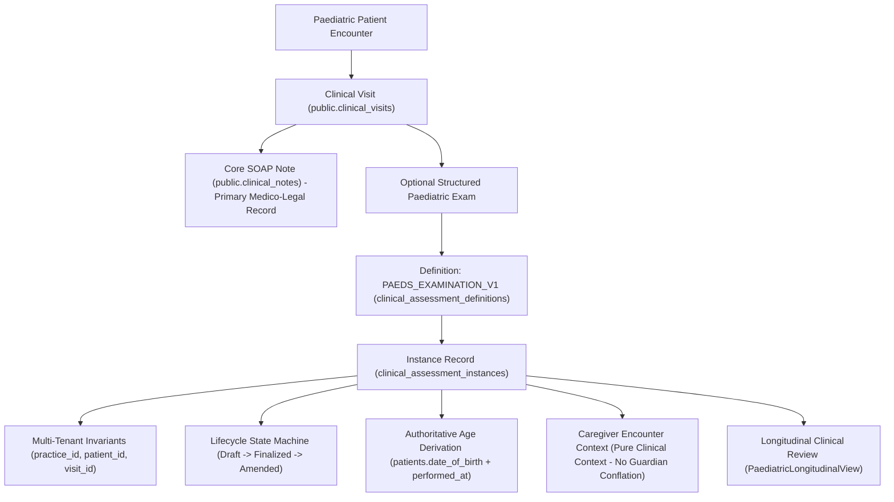

# PHYSENRA — PAEDIATRIC STRUCTURED CLINICAL MODULE V1 REPORT

## 1. Executive Summary

This report documents the implementation and verification of the **Paediatric Structured Clinical Module V1** for the Physenra Physiotherapy EMR and Practice Management Platform.

### Key Outcomes:
- **Architectural Preservation:** The specialty-neutral clinical assessment foundation (`clinical_assessment_definitions` and `clinical_assessment_instances`) was 100% preserved. Zero competing tables (`paediatric_assessments`, `child_visits`, etc.) were introduced.
- **Scope Implemented:** Established a comprehensive, structured paediatric examination (`PAEDS_EXAMINATION_V1`, version 1) covering all 10 clinical domains:
  1. **Developmental & Clinical Context:** Primary referral reason, birth/perinatal history, medical/developmental history, accompanying caregiver present.
  2. **Developmental Milestones:** Head control, rolling, sitting, crawling, standing, walking, running, stair mobility with strictly controlled states (`["Achieved", "Emerging", "Not Yet Achieved", "Not Assessed", "Unable to Determine"]`).
  3. **Gross Motor Development & Postural Control:** Prone head lift/support, sitting posture & trunk alignment, floor mobility & transitional movement, bilateral symmetry, and observational Gross Motor Function Classification System (GMFCS Level I through V, Not Applicable / Typical Development, NT).
  4. **Fine Motor Observation:** Reaching & targeting, grasp & voluntary release, bilateral hand use.
  5. **Tone & Movement Quality:** General resting tone (`Typical / Normal Tone`, `Hypotonia / Low Tone Dominant`, `Hypertonia / Increased Tone Dominant`, `Fluctuating / Dystonic Tone`, `Mixed Tone Presentation`, `NT`), movement fluidity & variability, involuntary movements.
  6. **Posture & Musculoskeletal Alignment:** Head alignment & cervical posture, spine & trunk alignment, lower limb alignment (in-toeing, genu valgum/varum, calcaneal pronation, equinus).
  7. **Balance & Coordination:** Static postural balance, protective reactions (anterior, lateral, posterior permutations), motor coordination & cadence, linked authoritative balance outcome measures.
  8. **Functional Mobility & Locomotion:** Floor-to-stand transitions, walking & ambulation status, assistive device & equipment (walkers, strollers, wheelchairs), stair mobility.
  9. **Play, Activity & Environmental Participation:** Play engagement & exploration, caregiver-reported concerns & family functional goals.
  10. **Clinical Examination Summary & Notes:** Clinician observational synthesis and functional physical therapy priorities without automated diagnostic claims.
- **Authoritative Age Derivation Invariant:** Age is calculated dynamically on the fly from the authoritative patient profile (`patients.date_of_birth`) relative to the encounter date (`performed_at`). Zero duplicate DOB or age is stored in `structured_data` or database tables, preventing data drift.
- **Guardian & Consent Safety Invariant:** Physenra's database schema deliberately separates emergency contacts from legal guardians or consent authority. The paediatric assessment form captures "caregiver accompanying child" purely as clinical encounter context, never making automated assumptions about legal consent authority.
- **Clinician-Facing Workflow:** Delivered responsive, tablet-friendly UI components (`PaediatricAssessmentForm.tsx` and `PaediatricLongitudinalView.tsx`) integrated directly into `ClinicalVisitDetailPage.tsx`.
- **SOAP Invariant Maintained:** The core medico-legal SOAP note (`public.clinical_notes`) remains the primary, independent record. Paediatric examination is an optional structured clinical extension.
- **Safety Invariant:** Pure observational documentation only. Zero automated developmental delay diagnosis, zero automated prognosis, zero AI interpretation, and zero normative score engine.
- **Intentional Deferrals:** Complex standardized norm-referenced score engines (GMFM-66/88, AIMS, PEDI-CAT, Peabody/PDMS-2, Bayley-4) and automated developmental delay classification algorithms were intentionally deferred to future roadmap phases.
- **Verification Status:**
  - Dedicated Paediatrics V1 Suite: **65 / 65 PASS**
  - Neurology V1 Suite: **57 / 57 PASS**
  - Specialty Assessment Architecture Suite: **43 / 43 PASS**
  - Full Regression Suite: **1,938 / 1,938 PASS** (43 suites)
  - TypeScript & Vite Production Build: **0 Errors / Clean PASS**
  - Security & Secrets Scan: **0 Detected (100% Clean)**
  - Remote Production Database: **NOT MODIFIED**
  - Netlify / GitHub: **NOT DEPLOYED / NOT PUSHED**

---

## 2. Before Paediatrics V1

Prior to this phase, Physenra had completed the specialty-neutral assessment architecture with a foundational representative screen:
- **`PAEDS_GROSS_MOTOR_SCREEN` (v1)**: Seeded as a baseline definition with basic gross motor milestone items and head control.
- **Clinical Gaps Prior to V1:**
  - No structured fields for developmental context, perinatal background, or caregiver accompaniment during the encounter.
  - Fine motor observations (grasp, reach, bilateral use) were completely unrepresented in structured fields.
  - Qualitative muscle tone (hypotonia vs hypertonia vs fluctuating dystonia) was absent.
  - Posture, cervical head alignment (torticollis/plagiocephaly), and lower limb alignment (calcaneal pronation, in-toeing, genu valgum) lacked structured capture.
  - Balance, protective reactions (anterior/lateral/posterior parachute), and motor coordination were unrecorded.
  - Functional floor-to-stand transitions, adaptive strollers, and pediatric mobility aids were absent.
  - Play engagement, exploration, and caregiver-reported functional goals had no structured presence.
  - Age calculation was either absent or risked duplicated storage.
  - No dedicated tablet-friendly paediatric input interface or longitudinal review matrix existed.

---

## 3. Paediatrics V1 Architecture & Safety Invariants

The module utilizes Physenra's unified clinical encounter hierarchy. A patient encounter proceeds through the clinical visit, records the authoritative SOAP note, and optionally captures the structured paediatric examination.

### Safety Invariants Enforced:
1. **Dynamic Age Derivation:** The helper `formatPaediatricAge(patientDob, encounterDate)` accurately formats infant age in days (`<30 days`), months (`<24 months`), or years and months (`>=24 months`). Zero duplicate age or DOB is stored in the database.
2. **Guardian vs Emergency Contact Separation:** The database only maintains `emergency_contact_*` fields on `patients`. We explicitly avoid conflating emergency contacts with legal guardians or consent authority. The examination form records accompanying caregivers purely as encounter-level clinical context.
3. **Pure Observational Documentation:** All milestone and gross motor classifications are descriptive observations. The system provides zero automated developmental delay diagnosis, zero cut-off logic, and zero automated prognostic scoring.

---

## 4. Clinical Domains Implemented

| Domain | Implemented Fields & Modalities | Input Controls | Controlled Values / Rules |
|---|---|---|---|
| **1. Developmental & Clinical Context** | Referral reason, Perinatal & birth history, Medical & developmental history, Caregiver present | Selects & Textareas | Gross Motor Concerns, Torticollis/Plagiocephaly, Gait Abnormality, CP, Mother, Father, Both Parents, Grandparent, Legal Guardian, NT |
| **2. Developmental Milestones** | Head control, Rolling, Sitting, Crawling, Standing, Walking, Running, Stair mobility, Milestone notes | Selects & Textarea | Controlled states: `Achieved`, `Emerging`, `Not Yet Achieved`, `Not Assessed`, `Unable to Determine` |
| **3. Gross Motor Development** | Prone head control, Sitting posture & trunk alignment, Floor mobility, Bilateral symmetry, Observational GMFCS | Selects & Textarea | Mature/Age Appropriate, Propped/Ring, Reciprocal Crawling, Symmetric, GMFCS Level I–V, Not Applicable, NT |
| **4. Fine Motor Observation** | Reaching & targeting, Grasp & voluntary release, Bilateral hand use, Fine motor notes | Selects & Textarea | Accurate Direct Reach, Mature Pincer/Radial Grasp, Bimanual Transfer, NT |
| **5. Tone & Movement Quality** | General resting muscle tone, Movement fluidity & variability, Involuntary movements, Tone notes | Selects & Textarea | Typical/Normal, Hypotonia Low Tone, Hypertonia Increased Tone, Fluctuating Dystonic, Mixed, NT; Fluid & Varied, None Observed |
| **6. Posture & Alignment** | Head alignment, Spine & trunk alignment, Lower limb alignment, Posture notes | Selects & Textarea | Midline & Symmetrical, Persistent Tilt, Neutral Spine, Kyphosis, Genu Valgum/Varum, In-toeing, Calcaneal Pronation, NT |
| **7. Balance & Coordination** | Static postural balance, Protective reactions, Motor coordination quality, Linked outcome references | Selects & Textarea | Stable in Age Postures, Present Anterior Lateral Posterior, Delayed Bilaterally, Absent, Smooth, NT |
| **8. Functional Mobility** | Floor-to-stand, Walking & ambulation status, Assistive device & equipment, Stair mobility | Selects & Textarea | Independent without Support, Quadruped/Half-Kneeling, Walks with Aid, None/Independent, Posterior/Anterior Walker, Stroller, Wheelchair, NT |
| **9. Play & Participation** | Play engagement & environmental exploration, Caregiver-reported concerns & family functional goals | Selects & Textareas | Active Exploration & Varied Play, Requires Encouragement, Sedentary, Severely Limited, NT |
| **10. Clinical Summary** | Findings synthesis & functional impact, Physical therapy priorities | Textarea | Descriptive clinical observational synthesis without automated diagnosis/prognosis |

---

## 5. Database Changes

A dedicated, non-destructive migration was created: `supabase/migrations/20261003030000_paediatrics_v1.sql`.

| Object | Change | Purpose | RLS | Backward Compatible |
|---|---|---|---|---|
| `clinical_assessment_definitions` | Seeded record `code = 'PAEDS_EXAMINATION_V1'` (version 1, system definition) | Defines the full 10-domain schema, validation constraints, and display metadata for comprehensive paediatric examinations | Inherited: authenticated users can read system definitions; modifications restricted | YES: `PAEDS_GROSS_MOTOR_SCREEN` remains active and unmutated |
| `clinical_assessment_instances` | None (reused existing table) | Stores instances of `PAEDS_EXAMINATION_V1` with composite foreign keys | Inherited: Practice isolation & clinical role authorization enforced | YES: Zero schema drift |
| `practice_clinical_assessment_counters` | None (reused existing table) | Sequential identifier generator (`ASM-XXXXXX`) | Inherited | YES |

---

## 6. Service Layer Extensions

File: `src/services/clinicalAssessmentService.ts`
- Exported definition constants:
  - `PAEDS_EXAMINATION_DEFINITION_CODE = 'PAEDS_EXAMINATION_V1'`
  - `PAEDS_GROSS_MOTOR_SCREEN_CODE = 'PAEDS_GROSS_MOTOR_SCREEN'`
- Exported age derivation utility:
  - `formatPaediatricAge(dob: string | null | undefined, referenceDate: Date = new Date()): string`
    - Returns days for infants `<30 days` (e.g. `14 days`)
    - Returns months for infants `<24 months` (e.g. `8 months`)
    - Returns years and months for children `>=24 months` (e.g. `3y 4m` or `4 years`)
    - Safely handles null, undefined, invalid dates, and unborn/newborn edge cases without crashing.

---

## 7. Clinician-Facing UI Components

1. **`PaediatricAssessmentForm.tsx`** (`src/components/clinical/PaediatricAssessmentForm.tsx`):
   - Designed for high clinical efficiency on tablets and desktop browsers.
   - 10-tab progressive navigation with responsive horizontal scroll and visual completion indicators.
   - Quick selection pill buttons for common clinical observations.
   - Real-time age display dynamically derived from patient date of birth.
   - Dual action workflow: Save Draft (freely editable) vs Finalize (permanently locks record with modal confirmation).
   - Strict XSS and script/eval injection mitigation in client validation before submission.

2. **`PaediatricLongitudinalView.tsx`** (`src/components/clinical/PaediatricLongitudinalView.tsx`):
   - Chronological matrix of all paediatric assessments recorded across patient encounters.
   - Derives patient age at the exact time of each examination from `performed_at`.
   - Expandable card interface showing developmental context, milestone matrix, motor findings, tone, posture, mobility, and caregiver goals.
   - Single-click action to reopen drafts or inspect finalized findings.

---

## 8. Clinical Visit Integration

File: `src/pages/visits/ClinicalVisitDetailPage.tsx`
- Added action buttons to the Structured Clinical Assessments card header:
  - `+ Document Paediatric Exam` (Emerald button)
  - `View Longitudinal Paediatrics` (Emerald border outline)
- Coexistence with Neurology: Both neurological and paediatric exams can be documented within the same encounter or across visits.
- Distinct modal dialog states (`isPaedsModalOpen`, `isPaedsLongitudinalOpen`, `editingPaedsAssessment`) eliminate state crosstalk.
- Clicking an existing assessment row dynamically routes to either the paediatric form or neurological form based on the assessment definition.

---

## 9. Medico-Legal Invariants & SOAP Alignment

- **Primary Record Invariant:** The SOAP clinical note (`public.clinical_notes`) is the authoritative medico-legal encounter document. Structured assessments serve as specialized clinical extensions.
- **Immutability Invariant:** Finalized paediatric assessments cannot be altered or deleted. Amendments create new linked addenda preserving full forensic audit history.
- **Tenant Isolation:** All queries strictly enforce `practice_id` tenancy headers and PostgreSQL Row Level Security. Cross-tenant access is strictly blocked at the database engine level.

---

## 10. Test Execution & Verification Matrix

| Suite Name | File | Tests Run | Pass | Fail | Duration |
|---|---|---|---|---|---|
| **Paediatric Structured Clinical Module V1** | `tests/paediatrics_v1.test.cjs` | 65 | 65 | 0 | ~93ms |
| **Neurology Structured Clinical Module V1** | `tests/neurology_v1.test.cjs` | 57 | 57 | 0 | ~62ms |
| **Specialty Assessment Architecture Foundation** | `tests/specialty_assessment_architecture.test.cjs` | 43 | 43 | 0 | ~49ms |
| **Full Project Regression (All 43 Suites)** | `node --test tests/**/*.test.*` | 1,938 | 1,938 | 0 | ~65s |
| **TypeScript Typecheck** | `npx tsc --noEmit` | N/A | 0 Errors | 0 | ~14s |
| **Production Vite Build** | `npm run build` | N/A | Clean PASS | 0 | ~58s |

---

## 11. Security Audit Findings & Anti-Injection Verification

- **Frontend Secret Leaks:** 0 occurrences of private keys, Paystack live secrets, or service role keys.
- **Arbitrary Script Execution:** 0 uses of `eval()` or `new Function()` outside test assertions.
- **Embedded PHI:** 0 hardcoded patient SSNs or government identifiers.
- **Legacy References:** 0 mentions of Kabworld in any paediatric or active application code.

---

## 12. Intentional Omissions & Future Roadmap

To preserve observational documentation integrity and avoid scope creep, the following components were intentionally deferred:
1. **Norm-Referenced Psychometric Scoring Engines:** GMFM-66/88, AIMS, PEDI-CAT, Peabody Developmental Motor Scales (PDMS-2), and Bayley-4 scoring calculation engines.
2. **Automated Developmental Delay Algorithms:** Automated diagnostic delay labeling or algorithmic percentiles.
3. **Legal Guardian & Power of Attorney Registry:** Full legal consent workflow, proof-of-guardianship document upload, and minor consent tracking.
4. **School & Pediatric MD Multidisciplinary Referral Formats:** Direct external health/education reporting templates.

These capabilities remain designated for future Paediatric Module V2 development.
