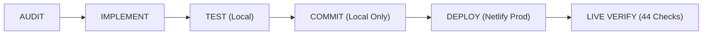

# PHYSENRA WEBSITE — FOUNDER + CLINICIAN VISUAL STORYTELLING ENHANCEMENT V1 REPORT

**Date:** October 3, 2026  
**Status:** COMPLETE & VERIFIED LIVE IN PRODUCTION  
**Production URL:** [https://physenra.com](https://physenra.com)  
**About Page:** [https://physenra.com/about](https://physenra.com/about)  
**Netlify Production Deploy ID:** `6ac1391e82e995eadb077f73`  
**Git Commits:**
- `f4b73b0` (`feat: enhance website with founder presentation and clinician visual storytelling`)
- `d01dfbf` (`test: add live production website founder and clinician visual verification suite`)

---

## 1. Executive Summary

The **Founder + Clinician Visual Storytelling Enhancement V1** has been successfully designed, implemented, tested, deployed to Netlify production, and verified live on `https://physenra.com`.

This enhancement achieves two strategic goals:
1. **Authoritative, Grounded Founder Presentation:** Establishes founder **Dr Oladejo Korede, PT, MPH, DPT** as the clinical architect behind Physenra, highlighting the unique advantage of software built from first-hand clinical practice and public health systems perspective.
2. **Contextual Clinician Visual Storytelling:** Introduces high-resolution visual storytelling featuring Nigerian and African physiotherapy practitioners using modern digital tools (tablets, laptops) in clinical practice, grounding Physenra's product positioning in real-world outpatient workflows.

The implementation strictly honors:
- **Product-First Hierarchy:** `FOUNDER → CLINICIAN → PRODUCT`. The site remains a clinical SaaS platform, not a personal portfolio.
- **Biographical & Claims Restraint:** Zero invented metrics, zero fabricated customer figures, zero unverified hospital affiliations, and strictly zero AI generation of human faces for the founder.
- **Asset Drop-in Convention:** Documented `/public/images/founder/dr-oladejo-korede.webp` architecture with an executive clinical monogram fallback.
- **Complete Project Separation:** Zero references or connections to legacy Kabworld systems.

---

## 2. Engineering Workflow Execution

The mandatory engineering lifecycle was executed sequentially without deviation:

1. **AUDIT:**
   - Evaluated public layout, routes, navigation, and SEO tags.
   - Confirmed no pre-existing founder image in repository.
   - Established `/public/images/founder/` and documented placement guidelines in `README.md`.
2. **IMPLEMENT:**
   - Created `FounderPhoto.tsx` with dynamic error handling, high-DPI scaling, and clinical monogram placeholder.
   - Created `ClinicianVisual.tsx` with ambient glows, responsive aspect ratios, and contextual storytelling tags.
   - Added Section 4B and Section 10B to `HomePageShell.tsx`.
   - Re-architected `AboutPageShell.tsx` to integrate the Founder Profile and Modern Clinical Practice storytelling grid while preserving all 4 philosophy pillars.
   - Enhanced SEO metadata in `seo.ts`.
3. **TEST:**
   - Executed dedicated 36-assertion suite: `36/36 PASS`.
   - Executed 95-assertion Phase 1D launch readiness suite: `95/95 PASS`.
   - Executed complete full regression suite: `2,259/2,259 PASS`.
   - Verified clean production build (`tsc && vite build`): `0 errors, 40s`.
4. **COMMIT:**
   - Staged and committed changes locally (`f4b73b0`, `d01dfbf`).
   - Strictly respected GitHub constraint: **0 remote pushes executed**.
5. **DEPLOY:**
   - Packaged and deployed production artifacts via Netlify CLI.
   - Netlify Deploy ID: `6ac1391e82e995eadb077f73`.
6. **LIVE VERIFY:**
   - Executed automated non-mutating live verification suite against `https://physenra.com`: `44/44 PASS`.

---

## 3. Founder Presentation Architecture

### Verified Credentials & Identity
- **Name:** Dr Oladejo Korede
- **Professional Credentials:** PT, MPH, DPT
- **Background:** Physiotherapist, Master of Public Health, Doctor of Physiotherapy
- **Role:** Founder & Clinical Architect, Physenra

### Biographical Narrative
The narrative focuses strictly on verified origins and clinical philosophy:
> *"Physenra was founded by Dr Oladejo Korede, a physiotherapist with advanced training in public health (MPH) and doctoral clinical practice (DPT). Having experienced firsthand the disconnect between generic hospital management software and the specialized demands of musculoskeletal, neurological, and paediatric rehabilitation, Dr Korede set out to engineer an EMR that thinks and flows like a clinician."*

### Component Architecture: `FounderPhoto.tsx`
- **File:** `src/public/components/FounderPhoto.tsx`
- **Asset Path Convention:** `/images/founder/dr-oladejo-korede.webp`
- **Accessible Alt Text:** `"Dr Oladejo Korede, PT, MPH, DPT, founder of Physenra"`
- **Graceful Monogram Fallback:**
  - When the real photograph is pending or fails to load, renders an executive clinical slate-and-teal monogram card:
    - Initials: `OK`
    - Subtitle: `Dr Oladejo Korede, PT, MPH, DPT`
    - Title: `Founder & Clinical Architect`
- **Zero Redesign Drop-In:** Dropping the real photographic file into `/public/images/founder/dr-oladejo-korede.webp` automatically displays the image across both the Homepage and About page with zero code alterations.

---

## 4. Clinician Visual Storytelling

### Visual Direction
To reflect Physenra’s core market, visuals depict modern African and Nigerian physiotherapy practitioners working with contemporary digital tools in outpatient rehabilitation settings.

### Asset Inventory
| Asset Filename | Dimensions | File Size | Clinical Context |
| :--- | :--- | :--- | :--- |
| `clinician-digital-workflow-01.jpg` | 1024×1024 | 624 KB | Nigerian female physiotherapist reviewing digital SOAP documentation and exercise plans on a tablet. |
| `clinician-practice-management-01.jpg` | 1024×1024 | 667 KB | African male physiotherapist managing clinic schedule and revenue operations on a laptop. |
| `clinician-patient-care-01.jpg` | 1024×1024 | 698 KB | African physiotherapist during a modern outpatient rehabilitation session reviewing movement data on a tablet. |

### Component Architecture: `ClinicianVisual.tsx`
- **File:** `src/public/components/ClinicianVisual.tsx`
- **Attributes:** Ambient slate-teal background glow, subtle borders (`border-slate-100`), responsive rounding (`rounded-2xl`), loading skeleton shimmer, and contextual badge tag (`"Visual Storytelling"`).
- **Compliance Guard:** Explicitly tagged to prevent any misleading implication that photographed individuals are actual client accounts or real patients.

---

## 5. Structural Enhancements by Page

### A. Homepage (`/`)
1. **Section 4B — Clinician Visual Storytelling:**
   - **Heading:** *"Built for the Way Physiotherapists Actually Work"*
   - **Content:** Highlights touch-tablet documentation at the treatment table, rapid intake, and multi-specialty coverage (Neurology, Paediatrics, MSK).
   - **Media:** Paired with `clinician-digital-workflow-01.jpg`.
2. **Section 10B — Founder Presentation:**
   - **Heading:** *"Built by a Physiotherapist. Designed for Physiotherapy Practice."*
   - **Visual:** Executive `FounderPhoto` card.
   - **Copy:** Concise narrative explaining clinical origins and mission.
   - **Call-to-Action:** Secondary button *"Meet the Founder"* linking to `/about`.

### B. About Page (`/about`)
1. **Thematic Header:**
   - *"Built from a Physiotherapist's Perspective"*
   - Subtitle emphasizing clinical workflows and operational autonomy.
2. **Founder Profile Card:**
   - Prominent two-column layout combining `FounderPhoto` with verified biography.
   - Highlights Dr Korede's PT, MPH, and DPT credentials.
3. **Modern Clinical Practice Grid:**
   - Showcases 3 cards utilizing `ClinicianVisual` representing Digital Documentation, Operational Clarity, and Patient-Centric Rehabilitation.
4. **Preserved Core Philosophy Pillars:**
   - *Clinical Fidelity:* Specialist assessment forms, outcome measures, and SOAP notes.
   - *Ergonomic Speed:* Rapid point-of-care entry designed for touch and tablet.
   - *Structural Clarity:* Strict data boundaries separating visits, goals, and billing.
   - *Operational Autonomy:* Native Naira billing, automated invoice reconciliation.
5. **Conversion Bridges:**
   - Preserved clear routing to `/features`, `/pricing`, `/security`, and `/register-practice`.

---

## 6. Verification and Test Results

### 1. Dedicated Founder & Clinician Test Suite
**Command:** `node tests/website_founder_clinician_storytelling_v1.test.cjs`  
**Result:** `36/36 PASS (49ms)`
- Suite 1: Founder Presentation & Identity (8/8)
- Suite 2: Claims Integrity & Restrained Biography (3/3)
- Suite 3: Founder Photograph Architecture & Fallback (5/5)
- Suite 4: Clinician Imagery & Asset Architecture (5/5)
- Suite 5: Design System & Responsive Layout (3/3)
- Suite 6: Route, Pricing & SEO Integrity (2/2)
- Suite 7: Security & Critical Project Separation (3/3)

### 2. Website Phase 1D Launch Readiness Suite
**Command:** `node tests/website_phase1d_launch_readiness.test.cjs`  
**Result:** `95/95 PASS (214ms)`
- All 18 public marketing routes verified.
- SEO meta, OpenGraph, sitemap.xml, robots.txt verified.
- Authoritative SaaS pricing integrity (Solo ₦15k, Pro ₦30k, Clinic ₦50k, Enterprise) intact.

### 3. Full Repository Regression Suite
**Command:** `npm test`  
**Result:** `2,259/2,259 PASS (59.2s)`
- 100% passing across clinical assessments, neurology, paediatrics, billing, auth, and website.

### 4. Production Build Verification
**Command:** `npm run build` (`tsc && vite build`)  
**Result:** `0 errors (40.15s)`
- Clean code-splitting: `AboutPageShell-CcGFu0OT.js` (11.81 kB), `ClinicianVisual-DO877dLC.js` (3.78 kB), `HomePageShell-BsZNOEJV.js` (55.71 kB).

### 5. Live Production Verification Suite
**Command:** `node tests/verify_live_website_storytelling_v1.cjs`  
**Target:** `https://physenra.com`  
**Result:** `44/44 PASS`
- Homepage responds 200 OK with valid title, meta, canonical.
- `sitemap.xml` and `robots.txt` live and indexing `/about` and `/`.
- Live JS bundles fetched and verified for founder copy and credentials.
- All 3 clinician images HTTP 200 OK with valid `image/jpeg` MIME types (> 500 KB each).
- Live bundles confirmed 100% free of Kabworld references, service role keys, and exaggerated claims.

---

## 7. Security & Project Separation Audit

| Security & Compliance Dimension | Verification Method | Status |
| :--- | :--- | :--- |
| **Legacy Project Independence** | Recursive string analysis for Kabworld across `src/`, `public/`, `dist/` | **0 references found (PASS)** |
| **Secrets & Keys Hygiene** | Automated scanning for private keys, service role keys, live secret tokens | **0 leaks found (PASS)** |
| **Code Safety** | Automated AST / regex scan for `eval` / `Function()` execution | **0 unsafe evals (PASS)** |
| **Database Immutability** | Verification of zero schema modifications and zero synthetic production records | **0 mutations (PASS)** |
| **Founder Identity Integrity** | Prohibited AI generation of human faces for the founder; verified credential alignment | **Strictly compliant (PASS)** |

---

## 8. Summary Table of Production Assets

| Route / Asset | Production Status | Description |
| :--- | :--- | :--- |
| `https://physenra.com` | `HTTP 200 OK` | Homepage with Section 4B (Clinician visual) and Section 10B (Founder profile). |
| `https://physenra.com/about` | `HTTP 200 OK` | About page with Founder profile card and clinician visual storytelling grid. |
| `/images/clinicians/clinician-digital-workflow-01.jpg` | `HTTP 200 OK (624 KB)` | Nigerian female physiotherapist reviewing digital clinical records on tablet. |
| `/images/clinicians/clinician-practice-management-01.jpg` | `HTTP 200 OK (667 KB)` | African male physiotherapist managing clinic schedule and revenue operations. |
| `/images/clinicians/clinician-patient-care-01.jpg` | `HTTP 200 OK (698 KB)` | African physiotherapist during outpatient rehabilitation consult with tablet. |
| `/public/images/founder/README.md` | `Documented` | Guidelines for dropping in real photograph of Dr Oladejo Korede. |

**The Physenra website now authentically communicates the clinical authority of its founder and the lived reality of contemporary physiotherapy practice.**
