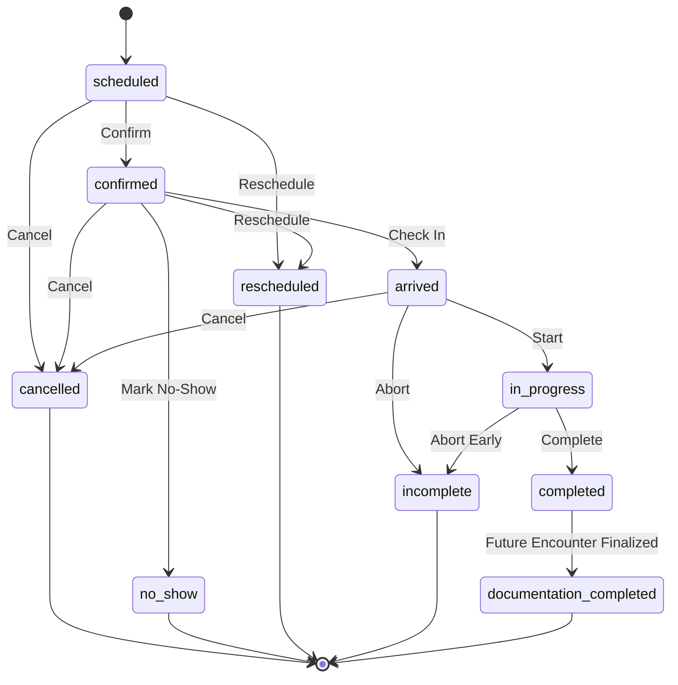

# PHYSENRA — APPOINTMENT & SCHEDULING FOUNDATION V1
**Architecture, Data Modeling, State Machine, Security & Boundary Specification**

---

## 1. Executive Summary & Clinical Domain Hierarchy

Physenra enforces strict boundary separation across the clinical and operational hierarchy:

$$\text{Patient (Durable Identity)} \longrightarrow \text{Episode of Care (Clinical Course)} \longrightarrow \text{Appointment (Scheduled Encounter)}$$
$$\Downarrow \text{ (Future Controlled Domains)}$$
$$\text{Clinical Visit (Actual Encounter)} \longrightarrow \text{Clinical Note (SOAP Documentation)}$$

### Core Identity Axioms
1. **Patient = Durable Identity**: Represents the person receiving care. Exists across time, independent of whether appointments are booked or episodes are active.
2. **Episode of Care = Clinical Course**: Represents a specific clinical condition, rehabilitation journey, or care objective (e.g., "Post-Op Left ACL Reconstruction").
3. **Appointment = Scheduled Encounter**: Represents an administrative, temporal reservation for care. **An appointment is NOT proof that treatment occurred, is NOT a clinical visit, and is NOT a clinical note.**
4. **Clinical Visit = Actual Encounter (Future Domain)**: Represents what actually transpired clinically when patient and clinician interacted.
5. **Clinical Note = Clinical Documentation (Future Domain)**: Represents the clinical evaluation, SOAP note, assessment, or outcome measures recorded by the clinician.

---

## 2. Appointment Purpose & Operational Scope

The Appointment & Scheduling Foundation V1 establishes:
- The ability to schedule, view, edit, reschedule, and cancel appointments within a multi-tenant practice.
- Association of an appointment with a patient and, optionally, a specific Episode of Care.
- Assignment of a responsible physiotherapist who is an active staff member of the practice.
- Deterministic temporal scheduling (date, start time, end time, duration).
- Controlled appointment lifecycle state machine.
- Conflict detection warning when a physiotherapist is double-booked.
- Human-readable sequential identifier generation (`APT-000001`).
- Multi-tenant defense in depth (composite foreign keys, immutability triggers, row-level security).

### Scope Boundary Guarantees (Zero Side-Effects)
In accordance with Physenra Architectural Rules:
- An appointment creation or completion does **NOT** consume package sessions.
- An appointment does **NOT** deduct patient wallet balances.
- An appointment does **NOT** generate invoices or process payments.
- Marking an appointment `completed` does **NOT** create a clinical encounter or mark treatment as completed.
- Zero clinical visit, clinical note, billing, or package tables are created in this phase.

---

## 3. Appointment Identity & Data Model

Technical Primary Key: `UUID` (`id`, generated database-side via `gen_random_uuid()`).  
Operational Identifier: `appointment_identifier` (Text, format `APT-000001`, unique per practice).

### Schema Specification (`public.appointments`)

| Column Name | Type | Modifiers / Constraints | Description |
| :--- | :--- | :--- | :--- |
| `id` | `uuid` | `PRIMARY KEY DEFAULT gen_random_uuid()` | Immutable technical surrogate key |
| `practice_id` | `uuid` | `NOT NULL REFERENCES public.practices(id)` | Owning practice tenant |
| `patient_id` | `uuid` | `NOT NULL REFERENCES public.patients(id)` | Associated patient |
| `episode_id` | `uuid` | `NULL REFERENCES public.episodes_of_care(id)` | Optional linked clinical episode |
| `physiotherapist_id` | `uuid` | `NOT NULL REFERENCES auth.users(id)` | Assigned clinician (must be active staff) |
| `appointment_identifier` | `text` | `NOT NULL` | Sequential human identifier (`APT-000001`) |
| `appointment_type` | `text` | `NOT NULL` | Type: `initial_consultation`, `follow_up`, `reassessment`, `home_visit`, `other` |
| `status` | `text` | `NOT NULL DEFAULT 'scheduled'` | Controlled state machine status |
| `scheduled_start` | `timestamptz` | `NOT NULL` | Start timestamp (with time zone) |
| `scheduled_end` | `timestamptz` | `NOT NULL` | End timestamp (`scheduled_end > scheduled_start`) |
| `duration_minutes` | `integer` | `NOT NULL CHECK (duration_minutes >= 5 AND duration_minutes <= 480)` | Duration in minutes |
| `location_mode` | `text` | `NOT NULL DEFAULT 'clinic'` | Mode: `clinic`, `home`, `telehealth`, `other` |
| `notes` | `text` | `NULL` | Administrative scheduling notes (not clinical documentation) |
| `cancellation_reason` | `text` | `NULL` | Captured if status transitions to `cancelled` |
| `cancelled_at` | `timestamptz` | `NULL` | Timestamp of cancellation |
| `cancelled_by` | `uuid` | `NULL REFERENCES auth.users(id)` | Staff member who cancelled |
| `rescheduled_from_id` | `uuid` | `NULL REFERENCES public.appointments(id)` | Pointer to prior appointment if rescheduled |
| `created_by` | `uuid` | `NULL REFERENCES auth.users(id)` | Creating staff member |
| `updated_by` | `uuid` | `NULL REFERENCES auth.users(id)` | Updating staff member |
| `created_at` | `timestamptz` | `NOT NULL DEFAULT now()` | Row creation timestamp |
| `updated_at` | `timestamptz` | `NOT NULL DEFAULT now()` | Last update timestamp |

---

## 4. Multi-Tenant Relational Defense in Depth

To mathematically guarantee tenant and patient isolation:

```
[public.patients] (id, practice_id)  <--- UNIQUE (id, practice_id)
        ^
        | Composite Foreign Key: fk_appointments_patient_practice
        |
[public.appointments] (patient_id, practice_id)
        |
        | Optional Composite Foreign Key: fk_appointments_episode_patient_practice
        v
[public.episodes_of_care] (id, patient_id, practice_id)  <--- UNIQUE (id, patient_id, practice_id)
```

1. **Patient-Practice Integrity:**
   - Composite foreign key `(patient_id, practice_id) REFERENCES public.patients(id, practice_id)` ensures the appointment and patient belong to the identical practice.
2. **Episode-Patient-Practice Integrity:**
   - Composite unique constraint `uq_episodes_id_patient_practice` on `public.episodes_of_care(id, patient_id, practice_id)`.
   - Composite foreign key `(episode_id, patient_id, practice_id) REFERENCES public.episodes_of_care(id, patient_id, practice_id)` ensures that if an episode is linked, it **MUST belong to the exact same patient AND the exact same practice**.
3. **Immutability Invariants (Triggers):**
   - `practice_id`, `patient_id`, `id`, and `appointment_identifier` are immutable once written.
   - Any attempt to alter them raises exception `EX_IMMUTABLE_APPOINTMENT_IDENTITY`.

---

## 5. Appointment Status State Machine

The appointment lifecycle is governed by an explicit finite state machine.

### Defined Statuses

| Status | Category | Description |
| :--- | :--- | :--- |
| `scheduled` | Initial | Appointment has been booked but not yet confirmed |
| `confirmed` | Active | Attendance confirmed by patient or front desk |
| `arrived` | Active | Patient has arrived at clinic (checked in) |
| `in_progress` | Active | Appointment time slot is actively underway |
| `completed` | Completed | Scheduled time slot has ended (does NOT imply clinical visit/SOAP) |
| `documentation_completed` | Reserved | Reserved for future integration when clinical encounter note is finalized |
| `cancelled` | Terminal | Appointment will not occur; requires `cancellation_reason` |
| `no_show` | Terminal | Patient failed to attend without prior notice |
| `rescheduled` | Terminal | Appointment was superseded by a newly scheduled appointment |
| `incomplete` | Terminal | Appointment commenced but was terminated prematurely |

### Allowed State Transitions



### Prohibited Transitions
- `cancelled` $\longrightarrow$ `completed` (Strictly Prohibited)
- `cancelled` $\longrightarrow$ `in_progress` (Strictly Prohibited)
- `no_show` $\longrightarrow$ `completed` (Strictly Prohibited)
- `rescheduled` $\longrightarrow$ `completed` (Strictly Prohibited)
- Any mutation of a terminal state (`cancelled`, `no_show`, `rescheduled`, `incomplete`) to an active state.

---

## 6. Scheduling, Duration & Conflict Detection Model

### Scheduling Model
- Appointments are stored with exact UTC-normalized `timestamptz` values: `scheduled_start` and `scheduled_end`.
- Duration is explicitly stored in `duration_minutes`.
- Invariant constraint: `scheduled_end = scheduled_start + (duration_minutes || ' minutes')::interval`.

### Conflict Detection Model
Conflict between two appointments $A$ and $B$ for the same clinician within a practice occurs if:
$$A.\text{physiotherapist\_id} = B.\text{physiotherapist\_id} \quad \wedge \quad A.\text{id} \neq B.\text{id}$$
$$\wedge \quad A.\text{scheduled\_start} < B.\text{scheduled\_end} \quad \wedge \quad A.\text{scheduled\_end} > B.\text{scheduled\_start}$$
$$\wedge \quad A.\text{status} \notin (\text{'cancelled'}, \text{'rescheduled'}, \text{'no\_show'})$$
$$\wedge \quad B.\text{status} \notin (\text{'cancelled'}, \text{'rescheduled'}, \text{'no\_show'})$$

- In the frontend service layer, an active conflict check inspects the schedule and provides proactive warnings or blockers to prevent inadvertent clinician double-booking.

---

## 7. Role-Based Access Control (RBAC) & Tenant Isolation

### RLS Policies on `public.appointments`
- **SELECT**: Restricted to actors whose `public.current_practice_id() = practice_id` and who hold an active membership role in `('practice_owner', 'practice_manager', 'physiotherapist', 'receptionist')`.
- **INSERT**: Restricted to active staff members in the matching practice context.
- **UPDATE**: Restricted to active staff members in the matching practice context.
- **DELETE**: Default Deny (no policy defined). Hard deletion of appointments is strictly prohibited. Cancellations must be performed via status transition.

---

## 8. Audit Event Strategy

Every significant appointment action triggers a call to `public.log_audit_event()`:
- `appointment.created`: Upon initial booking.
- `appointment.updated`: Upon modification of time, notes, or assigned clinician.
- `appointment.status_changed`: Upon transition (`scheduled` $\to$ `confirmed`, `arrived`, etc.).
- `appointment.cancelled`: Upon cancellation with reason.
- `appointment.rescheduled`: Upon rescheduling, logging both old and new appointment IDs.

---

## 9. Future Domain Handoff Interfaces

| Future Domain | Interface Boundary | What Appointment V1 Provides |
| :--- | :--- | :--- |
| **Clinical Visit** | `appointments.id` | Scheduled encounter metadata. Future `clinical_visits.appointment_id` will reference this record. |
| **Clinical Notes (SOAP)** | Via `clinical_visits` | Notes will link to the visit, not directly to the appointment slot. |
| **Billing / Invoices** | Via `clinical_visits` | Invoicing will be triggered by confirmed clinical attendance, never solely by booking an appointment. |
| **Package Consumption** | Via `clinical_visits` | Sessions will decrement only upon verified clinical encounter completion. |
