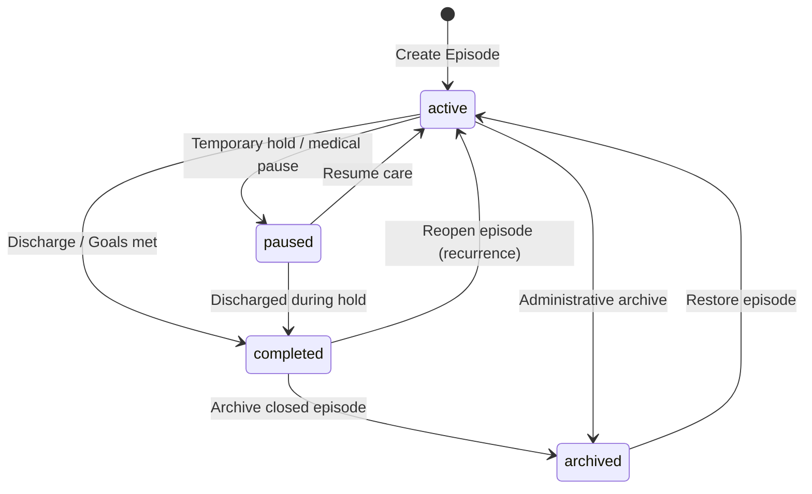

# Physenra Episode of Care Foundation V1 Architecture & Specification

## 1. Executive Summary & Purpose

The **Episode of Care Foundation V1** establishes the clinical course-of-care domain for the Physenra Physiotherapy EMR & Practice Management Platform.

In physiotherapy and musculoskeletal rehabilitation, clinical care is organized into discrete, problem-specific or condition-specific episodes (e.g., "Post-Op Left ACL Reconstruction", "Acute Cervical Radiculopathy", "Chronic Low Back Pain Rehabilitation").

### Foundational Distinction: The Clinical Hierarchy
Physenra enforces strict conceptual separation between clinical layers:
```
+-----------------------------------------------------------------------+
|  PATIENT (Durable Identity)                                          |
|  Demographics, contact info, lifelong practice identity record        |
+-----------------------------------┬-----------------------------------+
                                    | 1 : N
+-----------------------------------v-----------------------------------+
|  EPISODE OF CARE (Course of Care)                                     |
|  Condition, goals, care dates, responsible clinician                  |
+-----------------┬─────────────────────────────────┬-------------------+
                  | 1 : N                           | 1 : N
+-----------------v-----------------+ +-------------v-------------------+
|  APPOINTMENT (Scheduled Encounter)| |  TREATMENT PLAN (Future)        |
|  Calendar booking, time, status   | |  Structured clinical pathway    |
+-----------------┬-----------------+ +---------------------------------+
                  | 1 : 1
+-----------------v-----------------+
|  CLINICAL VISIT (Actual Encounter)|
|  Attendance, check-in, execution  |
+-----------------┬-----------------+
                  | 1 : N
+-----------------v-----------------+
|  CLINICAL NOTE (Documentation)    |
|  SOAP documentation, objective rx |
+-----------------------------------+
```

- **Patient:** The human receiving care; durable lifelong identity within the practice.
- **Episode of Care:** A clinically meaningful course of care for a specific injury, condition, or rehabilitation objective.
- **Appointment:** A scheduled slot on a clinician's calendar.
- **Clinical Visit:** The executed physical encounter where care took place.
- **Clinical Note:** The formal medical documentation (e.g. SOAP, evaluation) capturing the clinical findings and interventions of an encounter.

A patient may have multiple concurrent or sequential episodes of care over time. Patient clinical history must **never** be collapsed into a single monolithic record.

---

## 2. Multi-Tenant Ownership & Isolation

Every episode of care belongs strictly to a single practice (`practice_id`). Episodes are never shared across practices.

### Tenancy Principles:
1. **Authoritative Database Enforcement:** Row-Level Security (RLS) on `public.episodes_of_care` enforces isolation using `practice_id = public.current_practice_id()`.
2. **Context Synchronization:** The client supplies the active practice context via the HTTP header `x-practice-id`, validated against `public.practice_memberships`.
3. **Cross-Tenant Prevention:**
   - **Cross-tenant SELECT:** Denied at policy level.
   - **Cross-tenant INSERT:** Denied via `WITH CHECK (practice_id = public.current_practice_id())`.
   - **Cross-tenant UPDATE:** Denied via `USING` and `WITH CHECK`. Database triggers block mutating `practice_id`, `id`, or `patient_id`.
   - **Cross-tenant DELETE:** Zero hard deletes. No DELETE policy is granted to any role.

---

## 3. Patient Relationship & Database Integrity

An episode of care must always belong to a patient within the **same** practice.
To prevent cross-tenant patient assignment:
1. **Composite Database Constraint:** `public.patients` maintains a unique constraint on `(id, practice_id)`.
2. **Composite Foreign Key:** `public.episodes_of_care` enforces:
   ```sql
   FOREIGN KEY (patient_id, practice_id)
     REFERENCES public.patients(id, practice_id)
     ON DELETE RESTRICT
   ```
   This guarantees that an episode for Practice A can *never* reference a patient from Practice B, enforced declaratively by PostgreSQL.
3. **Trigger Invariant:** A before-insert/update trigger validates that `NEW.practice_id` matches `public.current_practice_id()` and rejects any patient mismatch.

---

## 4. Responsible Physiotherapist Assignment

An episode of care may have an assigned primary responsible physiotherapist (`primary_physiotherapist_id`):
1. **Membership Verification:** The assigned user must have an active membership in the same practice (`practice_memberships.practice_id = episodes_of_care.practice_id` with `status = 'active'`).
2. **Role Verification:** The assigned user must possess a clinician or clinical leadership role (`physiotherapist`, `practice_owner`, or `practice_manager`). Receptionists, accountants, and patients cannot be assigned as responsible clinicians.
3. **Trigger Guard:** The database trigger validates the clinician's active membership in the owning practice on INSERT and UPDATE.

---

## 5. Human-Readable Episode Identifier Strategy

Episodes of care use a stable, practice-scoped human-readable identifier:
- **Format:** `EOC-000001`, `EOC-000002`, etc.
- **Generation:** Generated atomically database-side via `public.practice_episode_counters` using a `SECURITY DEFINER` function `public.generate_next_episode_identifier(practice_id)`.
- **Practice-Scoped Uniqueness:** Enforced via `CONSTRAINT uq_episodes_practice_identifier UNIQUE (practice_id, episode_identifier)`.
- **PII-Free:** Derived solely from a database counter; contains zero patient initials, dates of birth, or injury descriptions.
- **Immutability:** Triggers block modifying `episode_identifier` after creation.

---

## 6. Episode Lifecycle & Status Model

Episodes transition through four explicit states:



- **`active`:** Ongoing treatment course. Appears in active caseloads and calendar schedules.
- **`paused`:** Temporarily on hold (e.g., patient awaiting surgeon review, illness, vacation).
- **`completed`:** Formal discharge from the course of care. `closed_at` and `closed_by` are stamped, and `end_date` is finalized.
- **`archived`:** Inactive, duplicate, or historical record retired from view. Soft-archived only.

### Reopening & Closure Invariants:
- Completing an episode records `closed_at = now()`, `closed_by = auth.uid()`, and sets `end_date = COALESCE(end_date, CURRENT_DATE)`.
- Reopening an episode clears `closed_at` and `closed_by` and transitions status to `'active'`.
- Archiving an episode sets `status = 'archived'`, `archived_at = now()`, and `archived_by = auth.uid()`.

---

## 7. Multiple Episodes Per Patient

1. **Independent Courses:** A patient can have multiple episodes (e.g., Left Knee Meniscectomy Rehab in 2024, Right Rotator Cuff Repair in 2026).
2. **Concurrent Episodes:** A patient may occasionally have two active episodes simultaneously (e.g., Post-surgical ankle rehab under Clinician A and Vestibular rehab under Clinician B).
3. **No Automatic Actions:**
   - Creating a patient does NOT create an episode.
   - Creating an episode does NOT close previous episodes.
   - All episode lifecycle actions are deliberate clinical decisions.

---

## 8. Role-Based Access Control (RBAC)

Permissions within the active practice context:

| Action | `practice_owner` | `practice_manager` | `physiotherapist` | `receptionist` | `accountant` | `patient` |
| :--- | :---: | :---: | :---: | :---: | :---: | :---: |
| **View Episodes** | Yes | Yes | Yes | Yes (Metadata) | Minimal (ID/Title) | Self-only (Deferred) |
| **Create Episode** | Yes | Yes | Yes | Yes | No | No |
| **Edit Details** | Yes | Yes | Yes | Yes (Admin) | No | No |
| **Complete / Reopen** | Yes | Yes | Yes | No | No | No |
| **Archive / Restore** | Yes | Yes | No | No | No | No |

---

## 9. Audit Trail Integration

All episode lifecycle events integrate with `public.log_audit_event()`:
- `episode_created`: Logged upon creation with episode identifier and patient ID.
- `episode_updated`: Logged when title, dates, or responsible clinician change.
- `episode_status_changed`: Logged on pause/resume transitions.
- `episode_completed`: Logged upon patient discharge from episode.
- `episode_reopened`: Logged when care is resumed.
- `episode_archived` / `episode_unarchived`: Logged on archive operations.

---

## 10. Future Integration Points

Durable foreign key targets for subsequent clinical modules:
- `appointments.episode_of_care_id -> episodes_of_care.id`
- `clinical_visits.episode_of_care_id -> episodes_of_care.id`
- `clinical_notes.episode_of_care_id -> episodes_of_care.id`
- `treatment_plans.episode_of_care_id -> episodes_of_care.id`
- `outcome_measures.episode_of_care_id -> episodes_of_care.id`
- `invoices.episode_of_care_id -> episodes_of_care.id` (optional direct billing link)
