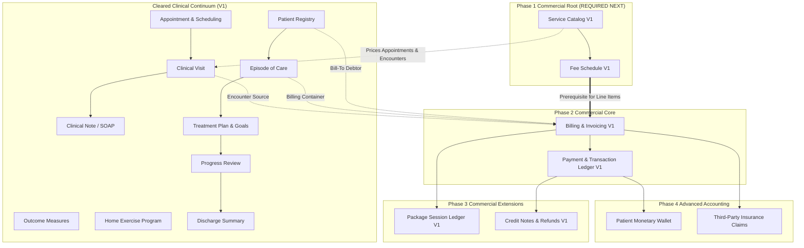

# PHYSENRA — POST-CLINICAL CONTINUUM ARCHITECTURE & NEXT DOMAIN DISCOVERY V1

```
================================================================================
ARCHITECTURE DISCOVERY AND SECURITY GATE REPORT
Product: Physenra Physiotherapy EMR & Practice Management Platform
Repository: C:\project\physenra
Supabase Project: xxknmdgneamtoahqayvl
Verified Base Commit: 701e7f1c298d3e56c73addabac6d598ffd2a5233
Current State: Clinical Continuum Cleared; Zero Commercial Domains Implemented
Gate Status: NEXT DOMAIN DISCOVERY — CLEARED
Authorized Next Domain: FEE SCHEDULE & SERVICE CATALOG FOUNDATION V1
================================================================================
```

---

## 1. CURRENT SYSTEM STATE

### 1.1 Repository & Branch Verification
- **Working Repository:** `C:\project\physenra`
- **Active Branch:** `main`
- **Head Commit:** `701e7f1c298d3e56c73addabac6d598ffd2a5233`
- **Commit Subject:** `feat: establish Physenra discharge summary foundation`
- **Working Tree:** Clean (zero unstaged changes, zero uncommitted code modifications)
- **Deployment Status:** NOT DEPLOYED (local/controlled Supabase test environment only)
- **GitHub Status:** NOT PUSHED (per non-negotiable offline verification protocol)

### 1.2 Remote Supabase Architecture
- **Supabase Reference:** `xxknmdgneamtoahqayvl`
- **Total Public Tables:** 30
- **Total Database Triggers:** 56 (covering tenancy immutability, state machines, audit events, sequential numbering, medico-legal lock)
- **Row-Level Security (RLS):** Enabled on 100% of public tables (30/30)
- **Tenancy Enforcement:** `practice_id = public.current_practice_id()` across all tenant-scoped tables with composite foreign keys
- **Application Test Suite:** 14 test suites, 388/388 tests passing (100% pass rate)
- **Development Server:** Active at `http://localhost:3000` (HTTP 200 OK)

---

## 2. CLEARED DOMAIN INVENTORY

The following 13 foundation domains are fully implemented, verified, and cleared:

| # | Domain Name | Database Objects | Service Layer | Frontend Pages / Routes | RLS & Security Status |
|---|---|---|---|---|---|
| **1** | **Database Foundation V1** | `practices`, `profiles`, `practice_memberships`, `subscriptions`, `audit_events` | Direct Supabase Client / Header State | `/app/practice`, `/login`, `/no-practice` | CLEARED: Multi-tenant RLS, immutable audit events, hierarchical RBAC |
| **2** | **Application Foundation V1** | App layout, auth context, practice context provider | `src/lib/supabase.ts`, `usePractice`, `useRole` | `/app/dashboard`, AppShell, Sidebar, Header | CLEARED: Active practice header injection, session verification |
| **3** | **Practice Bootstrap V1** | Idempotent provisioning script, `handle_new_user()` trigger | Dynamic email lookup, practice membership provisioning | `/no-practice` routing, Practice context selector | CLEARED: Self-injection prevention, owner privilege lock |
| **4** | **Patient Registry V1** | `patients`, `practice_patient_counters`, `generate_next_patient_identifier()` | `patientService.ts` | `/app/patients`, `/app/patients/new`, `/app/patients/:id`, `/app/patients/:id/edit` | CLEARED: `PAT-000001` sequential numbering, composite foreign keys, zero hard deletes |
| **5** | **Episode of Care V1** | `episodes_of_care`, `practice_episode_counters`, `generate_next_episode_identifier()` | `episodeService.ts` | `/app/episodes`, `/app/episodes/:id`, `/app/episodes/:id/edit` | CLEARED: `EOC-000001` sequencing, clinician assignment check, status state machine |
| **6** | **Appointment & Scheduling V1** | `appointments`, `practice_appointment_counters`, `generate_next_appointment_identifier()` | `appointmentService.ts` | `/app/appointments`, `/app/appointments/new`, `/app/appointments/:id`, `/app/appointments/:id/edit` | CLEARED: `APT-000001` sequencing, conflict detection matrix, canonical vocabulary |
| **7** | **Clinical Visit V1** | `clinical_visits`, `practice_clinical_visit_counters`, `generate_next_clinical_visit_identifier()` | `clinicalVisitService.ts` | `/app/visits`, `/app/visits/new`, `/app/visits/:id` | CLEARED: `VIS-000001` sequencing, appointment link, composite FKs, terminal lock |
| **8** | **Clinical Note / SOAP V1** | `clinical_notes`, `practice_clinical_note_counters`, `generate_next_clinical_note_identifier()` | `clinicalNoteService.ts` | `/app/clinical-notes`, `/app/clinical-notes/new`, `/app/clinical-notes/:id` | CLEARED: `NOT-000001` sequencing, medico-legal lock, addendum pattern, 1:1 primary SOAP |
| **9** | **Clinical Outcome Measures V1** | `outcome_measure_definitions`, `outcome_measure_assessments`, `practice_outcome_measure_counters` | `outcomeMeasureService.ts` | `/app/outcome-measures`, `/app/outcome-measures/new`, `/app/outcome-measures/:id` | CLEARED: Standard evidence-based definitions (NPRS, VAS, LEFS, ODI, QuickDASH), immutable scores |
| **10** | **Home Exercise Program V1** | `exercises`, `home_exercise_programs`, `home_exercise_program_items`, `practice_hep_counters` | `hepService.ts` | `/app/hep`, `/app/hep/new`, `/app/hep/:id` | CLEARED: Exercise catalogue, structured dosage/frequency, locked active programs |
| **11** | **Treatment Plan & Goals V1** | `treatment_plans`, `treatment_plan_goals`, `practice_treatment_plan_counters` | `treatmentPlanService.ts` | `/app/treatment-plans`, `/app/treatment-plans/new`, `/app/treatment-plans/:id` | CLEARED: SMART goals, priority/category taxonomy, baseline/target outcome linkages |
| **12** | **Milestone & Progress Review V1** | `progress_reviews`, `progress_review_goals`, `practice_progress_review_counters` | `progressReviewService.ts` | `/app/progress-reviews`, `/app/progress-reviews/new`, `/app/progress-reviews/:id` | CLEARED: `PRG-000001` sequencing, goal progress evaluations, formal amendment rationale |
| **13** | **Discharge Summary Foundation V1** | `discharge_summaries`, `practice_discharge_summary_counters`, `generate_next_discharge_summary_identifier()` | `dischargeSummaryService.ts` | `/app/discharge-summaries`, `/app/discharge-summaries/new`, `/app/discharge-summaries/:id` | CLEARED: `DS-000001` sequencing, atomic episode completion trigger, legal immutability |

---

## 3. CLINICAL CONTINUUM STATUS

With the completion of Discharge Summary Foundation V1, the entire clinical continuum has been formally closed:

$$\mathbf{Patient} \longrightarrow \mathbf{Episode\ of\ Care} \longrightarrow \mathbf{Treatment\ Plan} \longrightarrow \mathbf{Clinical\ Goals} \longrightarrow \mathbf{Progress\ Review} \longrightarrow \mathbf{Discharge\ Summary}$$

- Every step in the continuum has its own dedicated entity, state machine, composite foreign keys, and audit logging.
- An Episode of Care starts in `active`, progresses through evaluations, treatment plans, and milestones, and is atomically transitioned to `completed` when a Discharge Summary is finalized.
- **The clinical rehabilitation architecture is complete.** There is no clinical gap remaining before commercial domains can be introduced.

---

## 4. DOMAIN BOUNDARY AUDIT

A static analysis and database catalog inspection confirmed that **zero** commercial, financial, billing, or automated communication structures exist in the active Physenra database:

- **Fee Schedules & Service Catalog:** 0 tables, 0 columns.
- **Invoices & Billing Items:** 0 tables, 0 columns.
- **Payments, Transactions & Ledgers:** 0 tables, 0 columns.
- **Refunds & Credit Notes:** 0 tables, 0 columns.
- **Packages & Package Session Ledgers:** 0 tables, 0 columns.
- **Patient Wallets & Account Balances:** 0 tables, 0 columns.
- **Insurance, Payers & Claims:** 0 tables, 0 columns.
- **Patient Portal & Online Booking:** 0 tables, 0 columns.
- **AI Generations & Jobs:** 0 tables, 0 columns.
- **WhatsApp, SMS & Email Automation:** 0 tables, 0 columns.
- **Telehealth Infrastructure:** 0 tables, 0 columns.

All completed clinical domains strictly observe the separation firewall:
$$\text{Clinical\ Records} \neq \text{Billing} \neq \text{Invoices} \neq \text{Payments} \neq \text{Wallets} \neq \text{Packages} \neq \text{AI} \neq \text{WhatsApp}$$

---

## 5. COMMERCIAL DOMAIN INVENTORY

The following potential commercial domains were audited to establish their architectural scope and prerequisites:

1. **Fee Schedule & Service Catalog:** Codified directory of clinical and administrative services, standard prices, taxability, and effective date ranges.
2. **Billing & Invoicing:** Authoritative accounts receivable ($A/R$) generation for services delivered, missed appointments, or pre-purchased items.
3. **Payment & Transaction Ledger:** Immutable double-entry financial ledger recording cash, card, bank, or third-party money received and allocated to invoices.
4. **Package Session Ledger:** Pre-purchased service entitlement tracking (service bundle purchase $\rightarrow$ session allowance $\rightarrow$ consumption ledger $\rightarrow$ expiry/refund).
5. **Patient Wallet / Credit Ledger:** Prepaid monetary credit balance maintained on account for future invoice settlement.
6. **Refunds & Credit Notes:** Controlled reversals of billed amounts or returned funds with mandatory supervisor approval and rationale.
7. **Insurance & Claims:** Third-party billing, policy registration, claim generation, and remittance reconciliation.
8. **Financial Reporting & Day Sheet:** Aggregate reconciliation of daily cash, debtor balances, tax liabilities, and clinician billing productivity.

---

## 6. FEE SCHEDULE ANALYSIS

### 6.1 Purpose
A Fee Schedule establishes the financial valuation of billable clinical activities. Without a fee schedule, prices would be arbitrary free-text numbers typed by clinicians or receptionists at the time of invoicing, creating fraud risks, inconsistent revenue tracking, and reporting breakdown.

### 6.2 Key Architectural Requirements
- **Tenant Scoping:** Fee schedules must belong to a specific `practice_id`.
- **Effective Dating:** Prices change over time (e.g., annual price increases). An active fee schedule item must have `effective_from` and optional `effective_to`.
- **Historical Price Immutability:** When an invoice is created, it must snapshot the unit price from the fee schedule at that point in time. Future changes to the fee schedule must NEVER alter historical invoices.
- **Multi-Currency Support:** Practice-level currency code (e.g., `GBP`, `USD`, `EUR`, `CAD`, `AUD`).
- **Standard vs. Tiered Fees:** Foundation V1 should focus on a Standard Fee Schedule per practice before introducing insurer-specific or practitioner-specific tiered fee schedules.

---

## 7. SERVICE CATALOG ANALYSIS

### 7.1 Purpose
A Service Catalog defines the discrete billable products and clinical procedures offered by the physiotherapy practice. It links operational concepts (e.g., appointment types) to financial line items.

### 7.2 Minimum V1 Scope
- `service_code`: Short standardized mnemonic (e.g., `PT-INIT-60`, `PT-SUB-30`, `PT-HOME-60`, `PT-REASS-45`, `ADMIN-REPORT`).
- `name`: Human-readable service title (e.g., "Initial Musculoskeletal Assessment (60 min)").
- `description`: Detailed scope of what the service entails.
- `category`: Controlled enum (`initial_consultation`, `follow_up`, `reassessment`, `specialized_treatment`, `telehealth`, `administrative`, `product`).
- `default_duration_minutes`: Standard clinical time allocation (e.g., 30, 45, 60 min).
- `is_active`: Soft-deactivation toggle to prevent new billing of discontinued services without deleting historical records.
- `tax_rate`: Percentage or tax-exempt classification.

---

## 8. BILLING DEPENDENCY ANALYSIS

Billing (Invoicing) is the process of generating legal claims for payment ($A/R$).

### 8.1 What Billing Requires:
1. **Debtor / Bill-To Party:** A registered **Patient** (from Patient Registry V1).
2. **Clinical Context:** An **Episode of Care** (from Episode of Care V1) to associate the invoice with a clinical condition.
3. **Clinical Provenance:** An optional **Clinical Visit** (from Clinical Visit V1) or operational **Appointment** (from Appointment V1) to prove that the encounter occurred.
4. **Billable Items:** Codified **Services** from the **Service Catalog** (PREREQUISITE).
5. **Unit Valuation:** Established rates from the active **Fee Schedule** (PREREQUISITE).

### 8.2 Conclusion
**Billing CANNOT be implemented first.** Implementing Invoicing without a Service Catalog and Fee Schedule forces invoice line items to use unvalidated text and arbitrary prices, violating financial auditability and database normalization.

---

## 9. PAYMENT LEDGER ANALYSIS

A payment layer records the receipt of money ($Cash \rightarrow Cash\ at\ Bank$).

### 9.1 Architectural Principles:
- A payment is NOT merely an increment to a mutable account balance.
- It must be a **controlled append-only transaction ledger**:
  - `payment_identifier` (e.g., `PAY-000001`)
  - `amount`, `currency`
  - `payment_method` (`cash`, `card`, `bank_transfer`, `cheque`, `other`)
  - `reference_number` (terminal transaction ID, cheque number)
  - `allocation`: Linking the payment to one or more specific Invoices.
- Reversals must be recorded as explicit Refund transactions referencing the original payment, never in-place row deletion or balance decrement.

### 9.2 Conclusion
Payments require Invoices to allocate against. Payments cannot precede Invoicing.

---

## 10. PACKAGE / SESSION LEDGER ANALYSIS

A clinical package (e.g., "Block of 6 Rehabilitation Sessions") involves two distinct layers:
1. **Commercial Layer:** Purchasing the package. This is a standard commercial transaction that requires an **Invoice** and a **Payment**.
2. **Entitlement / Consumption Layer:** The package grants an allowance of sessions for a specific **Service**. When a patient attends a Clinical Visit, a session is deducted from the package ledger.

### 10.1 Distinction Between Money and Entitlement:
$$\mathbf{Monetary\ Purchase\ (Invoice/Payment)} \neq \mathbf{Service\ Entitlement\ (Session\ Ledger)}$$
- A package session is NOT a generic dollar balance; it is a voucher for a specific clinical service.
- Therefore, Packages require:
  - **Service Catalog** (to specify what service the package covers)
  - **Billing & Invoicing** (to purchase the package)
  - **Payment Ledger** (to pay for the package)
  - **Clinical Visit** (to record the visit during which a session is consumed)

### 10.2 Conclusion
Package Session Ledger cannot be implemented before Service Catalog, Billing, and Payments.

---

## 11. PATIENT WALLET ANALYSIS

### 11.1 Is a Monetary Wallet Required for Physenra V1?
In physiotherapy practice management:
- Most private clinics operate on **Point-of-Service (POS) billing** or **pre-purchased session packages**.
- A general monetary wallet (where patients deposit arbitrary cash balances to draw down over time) introduces banking compliance complexities, state-specific unearned revenue regulations, and potential consumer credit tracking.
- A wallet is **NOT a foundational prerequisite** for core practice management.

### 11.2 Architectural Recommendation
- Defer Patient Wallet to a later phase.
- Prioritize: Service Catalog $\rightarrow$ Invoicing $\rightarrow$ Payments $\rightarrow$ Packages.

---

## 12. REFUND & CREDIT NOTE DEPENDENCIES

### 12.1 Credit Notes vs. Refunds
- **Credit Note:** Reverses or reduces an Issued Invoice (reduces Accounts Receivable).
- **Refund:** Returns actual funds previously collected back to the payer (reduces Cash).

### 12.2 Dependencies
- Credit Notes depend strictly on **Billing & Invoicing**.
- Refunds depend strictly on **Payment Ledger**.
Both represent secondary adjustment mechanisms that sit on top of Invoicing and Payments.

---

## 13. INSURANCE & THIRD-PARTY CLAIMS DEPENDENCIES

In private physiotherapy:
- Self-pay patients represent the simplest commercial workflow.
- Insured billing requires:
  - Policy numbers, authorization codes, deductible tracking.
  - Insurer-specific fee schedules (contracted rates).
  - Claim submission documents (CMS-1500 / EDI 837 / electronic remittance EDI 835).
- Implementing Insurance before self-pay billing would unnecessarily inflate the schema with complex third-party payer hierarchies.

### 13.1 Architectural Recommendation
Build the self-pay commercial foundation first; design the data model so that third-party payer references can be attached cleanly to invoices later.

---

## 14. FINANCIAL DOMAIN SECURITY THREAT MODEL

The commercial layer introduces significant new threat vectors that must be mitigated by architectural controls:

| Threat ID | Threat Description | Architectural Mitigation |
|---|---|---|
| **THREAT-01** | **Cross-Tenant Billing / Payment Access** | Rigid enforcement of `practice_id = public.current_practice_id()` on all financial tables with composite foreign keys. |
| **THREAT-02** | **Unauthorized Price Modification** | Prices must originate from active Fee Schedule items. Invoice lines snapshot prices. Only `practice_owner` and `practice_manager` can alter Fee Schedules. |
| **THREAT-03** | **Retroactive Invoice Alteration** | Issued invoices must be permanently locked via database trigger. Zero in-place edits once issued. |
| **THREAT-04** | **Payment Concealment / Ledger Deletion** | Zero hard deletes on payment and ledger tables enforced by `trg_deny_*_hard_delete` triggers and RLS policies. |
| **THREAT-05** | **Concurrent Double-Spend (Packages/Credits)** | Strict row locking (`SELECT ... FOR UPDATE`) during session redemption and balance allocation. |
| **THREAT-06** | **Privilege Escalation on Refunds** | Only `practice_owner`, `practice_manager`, or `accountant` roles may authorize refunds or credit notes. Receptionists and physiotherapists are denied refund execution. |
| **THREAT-07** | **Tampering with Historical Audit Trail** | Financial transactions must execute `public.log_audit_event()` with immutable, tamper-resistant parameters. |

---

## 15. IMMUTABILITY PRINCIPLES FOR FINANCIAL RECORDS

The following strict immutability rules must be enforced when the financial layer is designed:

1. **Service Catalog Items:** Cannot be deleted if referenced by any historical fee schedule item or invoice. Soft deactivation (`is_active = false`) only.
2. **Fee Schedule Items:** Once effective, rates cannot be mutated retroactively. Any price update creates a new effective-dated row.
3. **Invoices:**
   - `draft`: Editable by authorized staff.
   - `issued`: Permanently locked. Content, lines, and amounts cannot be modified.
   - `voided`: Cancelled with mandatory audit reason; zero hard delete.
   - `paid`: Settled via payment allocations.
4. **Invoice Lines:** Snapshot unit price, tax rate, and service description at the time of creation.
5. **Payment Transactions:** 100% append-only. No updates, no deletes. Reversals require an offsetting refund transaction record.

---

## 16. ROLE / RBAC ANALYSIS (COMMERCIAL DOMAIN)

Physenra’s existing role taxonomy (`practice_owner`, `practice_manager`, `physiotherapist`, `receptionist`, `accountant`, `patient`, `platform_admin`) maps naturally to commercial capabilities:

| Role | Configure Services & Fees | Create Invoices | Record Payments | Issue Credit Notes / Refunds | View Financial Reports |
|---|---|---|---|---|---|
| **practice_owner** | Full Access | Full Access | Full Access | Full Access | Full Access |
| **practice_manager** | Full Access | Full Access | Full Access | Full Access (with limits) | Full Access |
| **accountant** | Read-Only | Full Access | Full Access | Full Access | Full Access |
| **receptionist** | Denied | Create & Issue | Record Receipts | Denied | Denied / Daily POS Only |
| **physiotherapist** | Denied | Create Draft | Denied | Denied | Denied |
| **patient** | Read (Public Menu) | View Own | Make Online Payment | Denied | Denied |

---

## 17. TENANT ISOLATION REQUIREMENTS

Every future commercial table must enforce multi-tenant isolation:
1. `practice_id UUID NOT NULL REFERENCES public.practices(id) ON DELETE RESTRICT`
2. Row-Level Security: `ALTER TABLE ... ENABLE ROW LEVEL SECURITY;`
3. Uniform policy: `practice_id = public.current_practice_id()`
4. Composite Foreign Keys:
   - Invoices: `FOREIGN KEY (patient_id, practice_id) REFERENCES public.patients(id, practice_id)`
   - Invoices: `FOREIGN KEY (episode_id, patient_id, practice_id) REFERENCES public.episodes_of_care(id, patient_id, practice_id)`
   - Invoice Lines: `FOREIGN KEY (clinical_visit_id, patient_id, practice_id) REFERENCES public.clinical_visits(id, patient_id, practice_id)`

---

## 18. POSTGREST RELATIONSHIP CONSIDERATIONS

Because future commercial tables will link to existing clinical tables across multiple pathways (e.g., an Invoice links to a Patient, an Episode, and multiple Clinical Visits), **PostgREST ambiguity is guaranteed to occur if foreign keys are not explicitly named and hinted**.

Every future service query must use explicit constraint hints:
- `patient:patients!fk_invoices_patient_practice (...)`
- `episode:episodes_of_care!fk_invoices_episode_patient_practice (...)`
- `visit:clinical_visits!fk_invoice_lines_visit_patient_practice (...)`
- `service:services!fk_invoice_lines_service_practice (...)`

---

## 19. RECOMMENDED DEPENDENCY GRAPH



---

## 20. CANDIDATE DOMAIN OPTIONS EVALUATION

### OPTION A: Fee Schedule & Service Catalog
- **Prerequisites:** None beyond cleared Database Foundation and Practice Context.
- **Dependents:** Billing, Invoicing, Payment Allocations, Packages, Reporting.
- **Security Risk:** Low to Moderate (price tampering risks easily mitigated by role locks and effective dating).
- **Architectural Importance:** **Foundational Root.**
- **Assessment:** Every downstream commercial entity requires codified services and rates. Without this, no invoice line can be typed or priced reliably.

### OPTION B: Billing & Invoicing
- **Prerequisites:** Service Catalog, Fee Schedule, Patient Registry, Episode of Care.
- **Dependents:** Payments, Credit Notes, Packages, Financial Reports.
- **Security Risk:** High ($A/R$ manipulation, unissued invoice leakage).
- **Architectural Importance:** Core transactional document.
- **Assessment:** Cannot precede Option A. Invoicing without a Service Catalog forces raw string descriptions and arbitrary prices into the ledger.

### OPTION C: Payment & Controlled Transaction Ledger
- **Prerequisites:** Billing & Invoicing, Service Catalog.
- **Dependents:** Refunds, Patient Account Balances, Cash Reconciliation.
- **Security Risk:** Critical (direct financial accounting and receipt manipulation).
- **Architectural Importance:** Secondary settlement layer.
- **Assessment:** Cannot precede Option B. Payments settle Invoices; without Invoices, payment allocation cannot occur cleanly.

### OPTION D: Package Session Ledger
- **Prerequisites:** Service Catalog, Billing & Invoicing, Payments, Clinical Visits.
- **Dependents:** Session consumption reporting.
- **Security Risk:** High (entitlement leakage, race conditions in session deduction).
- **Architectural Importance:** Tertiary product feature.
- **Assessment:** Packages bundle services (Option A) and are purchased via invoices (Option B). Cannot precede them.

### OPTION E: Patient Monetary Wallet
- **Prerequisites:** Service Catalog, Invoicing, Payments, Ledger Architecture.
- **Dependents:** Advanced prepaid deposit workflows.
- **Security Risk:** Extreme (storing unearned monetary deposits, banking regulatory risk).
- **Architectural Importance:** Optional / non-essential for initial outpatient clinic operations.
- **Assessment:** Should be deferred to a later maturity phase.

---

## 21. RECOMMENDED NEXT DOMAIN

Based on strict architectural dependency analysis:

$$\mathbf{RECOMMENDED\ NEXT\ DOMAIN:}\ \mathbf{FEE\ SCHEDULE\ \&\ SERVICE\ CATALOG\ FOUNDATION\ V1}$$

---

## 22. REASONING BASED ON DEPENDENCIES

1. **Singular Root Prerequisite:** A clinic cannot bill, take payment, bundle packages, or track revenue without knowing **what services it sells** and **how much it charges**.
2. **Clinical Translation Layer:** The Service Catalog bridges the operational/clinical vocabulary (`appointment_type: initial_consultation`, `duration_minutes: 60`) into billable items with codes, descriptions, and tax rates.
3. **Decoupled Safety:** Implementing the Fee Schedule & Service Catalog touches zero existing clinical tables, ensuring zero regression risk to the 13 cleared clinical domains.
4. **Data Integrity Guarantee:** When Invoicing (Domain 15) is subsequently implemented, it will be able to reference foreign keys directly to verified `services` and `fee_schedule_items`, eliminating free-text price manipulation.

---

## 23. SECURITY GATE REQUIREMENTS FOR NEXT DOMAIN

Before `Fee Schedule & Service Catalog Foundation V1` can be implemented, the following specifications must be established in its Design Phase:

1. **Tenancy:** Every service and fee schedule item must be strictly bound to `practice_id`.
2. **Immutability & Effective Dating:** A fee schedule item must have `effective_from` and optional `effective_to` dates. Active fee schedules cannot have their historical rates mutated in-place; rate changes require closing the prior date range and inserting a new version.
3. **Service Codes:** Unique per practice (`uq_services_practice_code`).
4. **Role Permissions:** Only `practice_owner` and `practice_manager` can insert, update, or deactivate services and fees. Physiotherapists and receptionists have read-only access.
5. **Auditing:** Every modification must log `service.created`, `service.updated`, `service.deactivated`, `fee_schedule.created`, `fee_schedule.item_added`, `fee_schedule.item_updated`.
6. **Zero Side-Effects:** The service catalog must NOT automatically trigger invoices or modify clinical visits.

---

## 24. FUTURE DOMAIN ORDER (ROADMAP)

Following the clearance of this discovery gate, the sequential domain roadmap is:

$$\begin{aligned}
\text{Step 14:}\ &\mathbf{Fee\ Schedule\ \&\ Service\ Catalog\ Foundation\ V1} \\
\text{Step 15:}\ &\mathbf{Billing\ \&\ Invoicing\ Foundation\ V1} \\
\text{Step 16:}\ &\mathbf{Payment\ \&\ Transaction\ Ledger\ Foundation\ V1} \\
\text{Step 17:}\ &\mathbf{Credit\ Notes\ \&\ Refunds\ V1} \\
\text{Step 18:}\ &\mathbf{Package\ Session\ Ledger\ Foundation\ V1} \\
\text{Step 19:}\ &\mathbf{Financial\ Reporting\ \&\ Day\ Sheet\ Reconciliation\ V1}
\end{aligned}$$

---

## 25. DOMAIN FIREWALL

The architectural firewall remains strictly in effect:
- Clinical encounters (Appointments, Visits, Notes, Plans, Reviews, Discharge Summaries) MUST NOT silently create invoices, payments, or deduct package sessions.
- Invoicing must always be an explicit, controlled commercial action.
- Third-party marketing tools, WhatsApp, AI, and patient portals remain strictly quarantined until the foundational practice management layer is verified.

---

## FINAL GATE VERDICT

```
================================================================================
NEXT DOMAIN DISCOVERY — CLEARED

AUTHORIZED NEXT DOMAIN:
  FEE SCHEDULE & SERVICE CATALOG FOUNDATION V1

RESTRICTIONS FOR CURRENT TURN:
  NO CODE IMPLEMENTATION
  NO MIGRATIONS
  NO FRONTEND CHANGES
  NO GIT COMMIT
  NO GITHUB PUSH
  NO DEPLOYMENT
================================================================================
```
