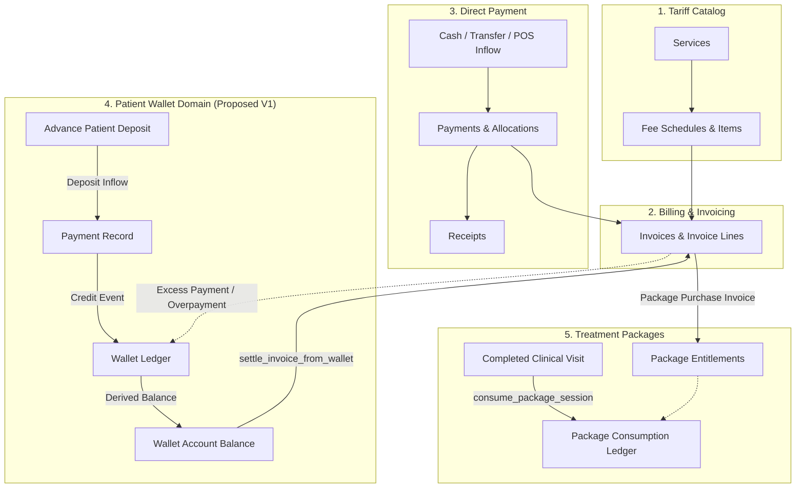

# PHYSENRA — PATIENT WALLETS V1
## Architecture Discovery & Security Gate Specification

---

### 1. EXECUTIVE SUMMARY

The Physenra Physiotherapy EMR & Practice Management Platform has established and verified its complete clinical continuum (Patient → Episode → Treatment Plan → Goals → Progress Review → Discharge Summary) and its core commercial foundation (Service Catalog → Fee Schedule → Billing & Invoicing → Payments & Receipts → Packages V1).

This document establishes the formal **Architecture Discovery and Security Gate** for the next commercial domain: **PATIENT WALLETS FOUNDATION V1**.

In outpatient physiotherapy practices, patients frequently maintain on-account monetary balances with their clinic. These arise from advance treatment deposits (e.g., depositing ₦150,000 in anticipation of an intensive rehabilitation protocol), cash or transfer overpayments on invoices, employer or family pre-funding, and commercial adjustments. Without an authoritative, audit-compliant wallet architecture, clinics resort to informal off-ledger tracking, spreadsheet balances, or dangerous balance column overrides, leading to billing discrepancies, double-spending, loss of financial reconciliation, and compliance exposure.

#### Core Discovery Determinations:
1. **Domain Definition (Prepaid Monetary Customer Deposit Liability)**:
   - A Patient Wallet in Physenra represents an **authoritative, on-account monetary balance** held in trust by the practice for a specific patient.
   - Economically, wallet credit is an **unearned customer deposit liability** on the clinic's books until drawn down to settle an authoritative debtor invoice issued by the clinic.
2. **Approved Architecture (Option E — Decoupled Wallet Account + Immutable Append-Only Ledger + Unified Invoice Settlement Allocation Bridge)**:
   - A patient wallet is established as an independent financial account (`patient_wallets`).
   - Every monetary movement (deposit, invoice settlement, adjustment, reversal) is immutably recorded in an append-only ledger (`patient_wallet_ledger`).
   - **Zero Mutable Balance Columns**: The wallet balance is derived deterministically from the ledger ($\text{Balance} = \sum \text{Credits} - \sum \text{Debits}$).
   - **Unified Settlement Pathway**: Wallets never bypass the authoritative invoice engine. Settle-from-wallet transactions integrate directly with invoice settlement invariants, ensuring single-source accounting truth.
3. **Strict Domain Firewalls**:
   - **Clinical Firewall**: Clinical documentation, SOAP notes, HEP prescriptions, and outcome assessments are completely decoupled from wallet balances. No clinician is ever blocked from documenting care due to wallet state.
   - **Package Firewall**: Wallet balance is stored fiat money; package entitlement is treatment session quota. Wallets can settle package invoices, but wallets cannot manufacture package sessions or bypass visit-driven consumption.
   - **Payment Firewall**: External monetary inflows (cash/POS/bank transfer) remain recorded in `payments`. Wallet credits derived from deposits are transparently linked to payment inflow records.
   - **Deferred Domains**: Recurring memberships, third-party payment gateways, external cash refunds, credit notes, FX conversion, and patient-to-patient wallet transfers are strictly deferred from V1.
4. **Physical Isolation**: Complete independence from external legacy systems is strictly maintained.

---

### 2. PRE-DISCOVERY AUDIT

An exhaustive audit of the Physenra codebase, repository, and remote Supabase database was conducted prior to designing the Patient Wallets architecture:

| Dimension | Verified State | Audit Evidence |
|---|---|---|
| **Repository Path** | `C:\project\physenra` | Local filesystem confirmed |
| **Active Branch** | `main` | `git branch` returned `main` |
| **HEAD Commit** | `904a270902cea64d28cc8779a240332c637601a6` | `git rev-parse HEAD` matched verified baseline |
| **Commit Message** | `feat: establish Physenra packages foundation` | Clean verified baseline |
| **Working Tree** | Clean | `git status` reports 0 unstaged / 0 untracked files |
| **Migration Sequence** | 18 applied migrations | Monotonically ordered in `supabase/migrations/` |
| **Supabase Project** | `xxknmdgneamtoahqayvl` | Connected via REST & Management API |
| **Public Database Tables** | 47 tables | 100% RLS coverage (47/47 tables active) |
| **Wallet Tables Exist** | 0 tables | Remote `pg_class` scan confirmed zero wallet tables |
| **Wallet RPCs Exist** | 0 functions | Remote `pg_proc` scan confirmed zero wallet functions |
| **Automated Test Suite** | 556 passing tests across 18 suites | 100% pass rate (`npm.cmd test`), 0 failures |
| **Production Build** | 0 TypeScript / Rollup errors | `npm.cmd run build` transformed 1,728 modules in 16.39s |
| **Legacy Isolation** | 100% independent from external legacy platforms | Zero matches for legacy strings in `src/` and `docs/` |

---

### 3. CURRENT COMMERCIAL ARCHITECTURE BASELINE

Physenra's commercial foundation operates across a strictly defined sequence:

$$\text{Service Catalog} \longrightarrow \text{Fee Schedule} \longrightarrow \text{Invoice} \longrightarrow \text{Payment / Receipt} \longrightarrow \text{Package Purchase} \longrightarrow \text{Package Entitlement} \longrightarrow \text{Completed Clinical Visit} \longrightarrow \text{Package Consumption Ledger}$$

The proposed addition of **Patient Wallets** introduces an on-account monetary liquidity layer:



#### Strict Conceptual Boundaries:
- **Service $\neq$ Fee**: A service is what is clinically performed; a fee is what it costs under a specific tariff.
- **Fee $\neq$ Invoice**: A fee is a rate in a catalog; an invoice is an authoritative demand for payment.
- **Invoice $\neq$ Payment**: An invoice demands money; a payment delivers money.
- **Payment $\neq$ Receipt**: A payment is cash inflow to the clinic; a receipt is an issued voucher certifying settlement.
- **Payment $\neq$ Package**: A payment is cash; a package is an operational quota of treatment sessions.
- **Package $\neq$ Entitlement**: A package is a catalog definition; an entitlement is a patient-specific session quota.
- **Package Purchase $\neq$ Package Consumption**: Purchase is commercial invoicing; consumption is clinical visit settlement.
- **Package $\neq$ Wallet**: A package represents non-monetary treatment units for specific modalities; a wallet represents generic fiat monetary value.
- **Payment $\neq$ Wallet Credit**: A payment is an external cash transaction; wallet credit is an internal on-account ledger claim.
- **Wallet Credit $\neq$ Credit Note**: Wallet credit is customer cash held in trust; a credit note is a formal accounting reduction of invoice demand.
- **Wallet Credit $\neq$ Refund**: Wallet credit retains funds inside the practice; a refund disburses cash out of the practice back to the patient.

---

### 4. WALLET DOMAIN DEFINITION & FINANCIAL CONCEPTS

In Physenra, a **Patient Wallet** is defined as:
> An authoritative, multi-tenant monetary store representing unapplied patient funds held in trust by a healthcare practice, usable exclusively for the future settlement of practice invoices.

#### Fundamental Questions & Architectural Answers:

1. **What does a wallet balance actually represent?**
   - It represents an **unearned customer deposit liability** (prepaid customer balance). The practice owes the patient services or invoice credits equivalent to the deposited fiat amount.
2. **Who owns the funds?**
   - The **patient** retains equitable ownership of the unapplied funds; the **practice** acts as financial custodian.
3. **When does money enter the wallet?**
   - Money enters the wallet upon:
     - An **Advance Deposit**: The patient pays money in advance without an immediate invoice (accompanied by a payment record and deposit receipt).
     - An **Invoice Overpayment Conversion**: A patient pays more than an invoice balance due, and the surplus is explicitly transferred to their wallet.
     - An **Administrative Credit Adjustment**: Practice management issues an authorized discretionary credit (e.g., service resolution).
4. **When does money leave the wallet?**
   - Money leaves the wallet upon:
     - **Invoice Settlement**: Wallet credit is drawn down to pay an issued invoice in full or in part.
     - **Administrative Debit Adjustment**: Practice management corrects a clerical deposit error or charges an authorized fee.
     - **Account Closure / Administrative Forfeiture**: Authorized closure of an abandoned wallet account.
5. **Can wallet credit be transferred between patients?**
   - **NO**. Strictly prohibited in V1. Wallet balances are strictly bound to a single patient within a single practice to prevent fraud, misattribution, and anti-money laundering compliance breaches.
6. **Can wallet credit expire?**
   - **NO**. In V1, customer deposits held as cash do not arbitrarily expire. Any future forfeiture policy must comply with legal unclaimed property/deposit regulations and is deferred from V1.
7. **Can wallet credit be refunded?**
   - External cash/bank disbursements (refunds) are **DEFERRED** in V1. If a deposit was recorded in error, the deposit transaction can be voided via atomic reversal within the standard payment void window.
8. **Can wallet credit be manually adjusted?**
   - Yes, but strictly through authorized Owner/Manager roles with mandatory written justification and an immutable ledger entry. Arbitrary balance overrides (`balance = X`) are architecturally impossible.
9. **Can a patient have separate wallets by currency?**
   - Yes, conceptually. Each wallet account is uniquely identified by `(practice_id, patient_id, currency)`. However, V1 standardizes on single practice currency (NGN default), with cross-currency conversion (FX) strictly deferred.
10. **Can a practice have a general wallet?**
    - **NO**. Wallets belong strictly to patients. Practice operating accounts are external accounting concerns outside the EMR domain.

---

### 5. CRITICAL FINANCIAL DISTINCTIONS

```
+----------------------------------------------------------------------------------------------------+
|                                FINANCIAL ENTITY SEPARATION MATRIX                                  |
+----------------------+--------------------+---------------------+----------------------------------+
| Entity               | Classification     | Primary Purpose     | Invariant                        |
+----------------------+--------------------+---------------------+----------------------------------+
| Payment              | Asset Inflow       | Inflow of real fiat | Confirmed cash inflow; immutable |
| Payment Allocation   | Settlement Bridge  | Applies cash to inv | Total alloc <= payment amount    |
| Invoice Balance      | Asset Receivable   | Amount owed by pat  | grand_total - amount_paid        |
| Wallet Balance       | Liability (Deposit)| Patient on-account  | Derived: SUM(ledger) >= 0        |
| Package Entitlement  | Operational Quota  | Session units       | Non-monetary treatment units     |
| Credit Note          | Demand Adjustment  | Cancels invoiced AR | Formal reduction of invoice debt |
| Refund               | Asset Outflow      | Disburses cash out  | Payout back to patient (deferred)|
+----------------------+--------------------+---------------------+----------------------------------+
```

---

### 6. ARCHITECTURE OPTIONS EVALUATION

#### Option A: Mutable Wallet Balance Column (`patient_wallets.balance`)
- **Concept**: A simple table with a `balance NUMERIC(12,2)` column updated in-place on every transaction.
- **Strengths**: Trivial to implement; fast single-row reads.
- **Fatal Weaknesses**:
  - Catastrophic concurrency vulnerability: Two simultaneous requests (e.g., receptionist checking out encounter while cashier settles an invoice) result in lost updates or negative balances.
  - Zero auditability: An update changes the number but destroys the history of *why* it changed.
  - Reconciliation impossibility: If the balance column drifts from external records, there is no mathematical proof of which transaction caused the drift.
- **Verdict**: **REJECTED (Unacceptable Financial & Concurrency Risk)**.

#### Option B: Wallet as a Special Invoice/Payment Construct
- **Concept**: Overload `invoices` (with negative amounts) or `payments` (with dummy unallocated flags) to simulate wallet credits without new tables.
- **Strengths**: Reuses existing tables.
- **Fatal Weaknesses**:
  - Severely pollutes double-entry invoice accounting.
  - Negative invoice lines break tax calculations, fee schedule snapshots, and reporting.
  - Confuses accounts receivable with customer deposit liabilities.
- **Verdict**: **REJECTED (Severe Accounting & Structural Conflation)**.

#### Option C: Standalone Wallet Account + Append-Only Ledger (`patient_wallets` + `patient_wallet_ledger`)
- **Concept**: Model wallets as independent accounts with an append-only transaction ledger. Balance is derived: $\text{Balance} = \sum \text{Credits} - \sum \text{Debits}$.
- **Strengths**: Complete audit trail, mathematical immutability, zero drift, clean reversals, tenant isolation.
- **Weakness**: Does not explicitly define how wallet debits interact with the existing `payments` and `invoices` settlement tables.
- **Verdict**: **SOUND FOUNDATION, BUT INCOMPLETE SETTLEMENT SPECIFICATION**.

#### Option D: Wallet as Unapplied Payment Balance
- **Concept**: Maintain no separate wallet entity; treat any payment where $\text{amount} > \sum \text{allocated}$ as an implicit wallet.
- **Strengths**: Direct link to cash receipts.
- **Fatal Weaknesses**:
  - Fragmented balances: A patient with three partial overpayments has three fragmented "wallets" rather than one unified patient account.
  - Cannot support administrative credits or non-payment adjustments.
  - Makes FIFO/LIFO allocation across multiple old payments extremely fragile.
- **Verdict**: **REJECTED (Fragile Allocation Engine & Poor User Experience)**.

#### Option E (RECOMMENDED): Decoupled Wallet Account + Append-Only Ledger + Dedicated Wallet Settlement Allocation Bridge
- **Concept**:
  1. A dedicated `patient_wallets` account header per `(practice_id, patient_id, currency)`.
  2. A strictly append-only `patient_wallet_ledger` tracking all credits, debits, adjustments, and reversals.
  3. **Derived Balance Authority**: Zero mutable balance column. Row lock (`SELECT ... FOR UPDATE` on `patient_wallets`) prevents race conditions.
  4. **Dedicated Wallet Settlement Bridge**: When wallet funds settle an invoice:
     - An append-only debit row is written to `patient_wallet_ledger` (`entry_type = 'invoice_settlement'`, `invoice_id = X`).
     - An authoritative settlement record is generated in the payment allocation pipeline (`payment_allocations` marked with internal payment type `wallet`), incrementing `invoice.amount_paid` and decrementing `invoice.balance_due`.
     - An authoritative receipt is issued for the invoice settlement.
- **Strengths**: Complete financial integrity, zero race conditions, double-entry auditability, seamless integration with Billing V1, full isolation of clinical care.
- **Verdict**: **APPROVED ARCHITECTURE FOR PHYSENRA WALLETS V1**.

---

### 7. PERMITTED & PROHIBITED MONEY FLOWS (V1 MATRIX)

| Flow ID | Scenario | Status | Authoritative Entity | Ledger Entry | Balance Effect | Reversal Behavior |
|---|---|---|---|---|---|---|
| **FLOW 1** | Patient pays invoice exactly | Permitted | `payments` + `payment_allocations` | None (Direct payment) | No wallet effect | Void payment voids allocation |
| **FLOW 2** | Patient pays less than invoice | Permitted | `payments` + `payment_allocations` | None (Partial payment) | No wallet effect | Void payment voids allocation |
| **FLOW 3** | Patient pays more than invoice | Permitted | `payments` + `wallet_ledger` | `credit` (overpayment conversion) | Wallet increases by surplus | Voiding payment reverses credit |
| **FLOW 4** | Patient deposits advance cash | Permitted | `payments` + `wallet_ledger` | `credit` (advance_deposit) | Wallet increases by deposit | Voiding deposit reverses credit |
| **FLOW 5** | Payment becomes void | Permitted | `payments` + `wallet_ledger` | `debit` (payment_void_reversal) | Reverses created credit | Preserved append-only trace |
| **FLOW 6** | Wallet settles invoice in full | Permitted | `wallet_ledger` + `payment_allocations` | `debit` (invoice_settlement) | Wallet decreases by invoice | Voiding settlement restores credit |
| **FLOW 7** | Wallet partially settles invoice| Permitted | `wallet_ledger` + `payment_allocations` | `debit` (invoice_settlement) | Wallet decreases to 0; inv has bal | Voiding settlement restores credit |
| **FLOW 8** | Wallet balance insufficient | Permitted | `wallet_ledger` + cash payment | `debit` (draws max available) | Wallet depleted; balance due remains | Standard partial settlement rules |
| **FLOW 9** | Invoice voided after wallet pay| Permitted | `invoices` + `wallet_ledger` | `credit` (settlement_refund_reversal)| Restores funds to wallet | Audit event logged |
| **FLOW 10**| Multiple invoices exist | Permitted | `wallet_ledger` + `payment_allocations` | Discrete debit per invoice | Wallet decreases by sum | Each allocation independently traced|
| **FLOW 11**| Wallet credit across invoices | Permitted | `wallet_ledger` + `payment_allocations` | N ledger debit rows | Wallet decreases by total | Discrete per-invoice ledger rows |
| **FLOW 12**| Duplicate payment recorded | Permitted | `payments` (void second payment) | `debit` (void_reversal) | Neutralizes duplicate credit | Append-only void entry |
| **FLOW 13**| Manual adjustment required | Permitted | `wallet_ledger` | `credit` / `debit` (adjustment) | Adjusts by signed amount | Mandatory reason ($\ge 10$ chars) |
| **FLOW 14**| Patient requests cash back | **PROHIBITED**| None (Cash refunds deferred) | None (Deferred to Refund phase) | Funds remain in wallet | Out-of-band clinic cash management |
| **FLOW 15**| Patient changes practice | **PROHIBITED**| None (Cross-practice transfer) | None (Strict tenant boundary) | Cannot transfer to other practice | Distinct wallet per practice |

---

### 8. UNAPPLIED PAYMENTS & OVERPAYMENTS ARCHITECTURE

A common architectural failure in healthcare billing is the **silent, automatic conversion** of excess payments into wallet balances. Physenra strictly forbids silent conversion.

#### Unapplied Payment Rule:
1. When a payment is received without an invoice, it MUST be recorded explicitly as an **Advance Patient Deposit**.
2. Advance Patient Deposits generate:
   - A `payments` record with `payment_method` (`cash`, `bank_transfer`, `pos`, etc.).
   - A `receipts` record with `status = 'issued'` certifying the deposit.
   - An immediate, linked `patient_wallet_ledger` entry (`entry_type = 'deposit'`).
3. An unallocated payment CANNOT sit in limbo without a defined home: it is either allocated to an invoice or deposited into the wallet.

#### Overpayment Rule:
1. Scenario: Invoice grand total = ₦100,000. Patient transfers ₦120,000.
2. In Physenra V1, the receptionist/cashier records:
   - Payment inflow = ₦120,000.
   - Payment allocation to invoice = ₦100,000 (Invoice transitions to `status = 'paid'`, `balance_due = 0.00`).
   - The remaining ₦20,000 is explicitly routed to **Wallet Deposit** with patient consent.
   - A ledger entry is written: `entry_type = 'overpayment_credit'`, `amount = 20000.00`, `source_payment_id = payment.id`, `source_invoice_id = invoice.id`.
3. Financial Invariant:
   $$\text{Payment Inflow (120,000)} = \text{Invoice Allocation (100,000)} + \text{Wallet Credit (20,000)}$$
   No funds are lost, and no silent mutation occurs.

---

### 9. WALLET CREDIT CREATION & DEBIT MECHANICS

#### Permitted Credit Sources in V1:
1. `deposit`: Direct cash, bank transfer, or card deposit made by the patient.
2. `overpayment`: Explicit allocation of excess invoice payment.
3. `adjustment_credit`: Discretionary administrative credit authorized by Owner or Manager.
4. `reversal_credit`: Reversal of an invoice settlement when an invoice is voided.

#### Permitted Debit Targets in V1:
1. `invoice_settlement`: Settle full or partial balance due on an issued clinic invoice.
2. `adjustment_debit`: Discretionary administrative debit/correction authorized by Owner or Manager.
3. `payment_void_reversal`: Reversal of credit when an underlying deposit payment is voided.

---

### 10. BALANCE AUTHORITY & CONCURRENCY CONTROL

#### Derived Balance Authority:
In strict conformance with Physenra financial architecture:
$$\text{Wallet Balance} = \sum_{\text{entry} \in \text{Ledger}} \text{signed\_amount}$$
- **Zero Mutable Balance Column**: `patient_wallets` contains NO `balance` column.
- Balance is computed dynamically or materialized via transactional queries.
- Under NO circumstance may a wallet balance become negative:
  $$\text{Wallet Balance} \ge 0.00 \quad (\text{Strict Invariant})$$

#### Concurrency & Race-Condition Protection:
To eliminate double-spending under concurrent requests:
1. Every state-altering wallet RPC acquires an exclusive row lock on the parent wallet header:
   ```sql
   SELECT id, status, currency INTO v_wallet
   FROM public.patient_wallets
   WHERE id = p_wallet_id AND practice_id = p_practice_id
   FOR UPDATE;
   ```
2. While the lock is held, the current balance is calculated:
   ```sql
   SELECT COALESCE(SUM(amount), 0.00) INTO v_current_balance
   FROM public.patient_wallet_ledger
   WHERE wallet_id = v_wallet.id;
   ```
3. If a debit amount exceeds `v_current_balance`, the transaction immediately aborts with an exception:
   `Validation failure: Insufficient wallet balance (available: X, requested: Y).`
4. The ledger row is inserted, and the transaction commits.

---

### 11. PAYMENT VOID & REVERSAL HANDLING

When a payment that originally funded a wallet credit is voided (e.g., bounced bank transfer, POS chargeback):
1. **Detection**: The system verifies whether any portion of the voided payment was credited to a wallet.
2. **Atomic Reversal**:
   - If wallet credit remains unspent: An offsetting `debit` row (`entry_type = 'payment_void_reversal'`) is appended to `patient_wallet_ledger`.
   - If wallet credit has already been spent to settle an invoice: The wallet cannot be driven negative. In V1, voiding a payment whose credit has already been consumed requires administrative intervention: the dependent invoice settlement must be voided/reverted first, or an administrative debit is flagged for manager review.
3. **Immutability Guarantee**: Historical ledger rows are **NEVER deleted or updated**. Offsetting reversal rows preserve complete financial provenance.

---

### 12. PACKAGE INTEGRATION & BOUNDARIES

1. **Purchasing a Package using Wallet Funds**:
   - A patient desires to purchase a "10-Session Rehab Package" costing ₦150,000.
   - Receptionist initiates `purchase_package`, generating an authoritative debtor invoice for ₦150,000.
   - Receptionist selects "Pay from Wallet".
   - `settle_invoice_from_wallet` executes:
     - Debits ₦150,000 from `patient_wallet_ledger`.
     - Allocates ₦150,000 to the package invoice.
     - Invoice marks `status = 'paid'`, `balance_due = 0.00`.
     - The package trigger `sync_package_entitlement_on_invoice_change` detects full settlement and activates the package entitlement.
2. **Strict Firewall**:
   - Wallet funds DO NOT equal package sessions.
   - Wallet debit DOES NOT directly create package sessions.
   - Package consumption remains driven solely by completed clinical visits.

---

### 13. ROLE-BASED ACCESS CONTROL (RBAC) MATRIX

Existing Physenra roles only (zero new roles created):

| Operation | Owner | Manager | Accountant | Receptionist | Physiotherapist | Patient |
| :--- | :---: | :---: | :---: | :---: | :---: | :---: |
| View Patient Wallet & Balance | Yes | Yes | Yes | Yes | Yes (View Only) | Yes (Own Only) |
| View Detailed Wallet Ledger | Yes | Yes | Yes | Yes | No | Yes (Own Only) |
| Record Advance Deposit | Yes | Yes | Yes | Yes | No | No |
| Convert Overpayment to Wallet | Yes | Yes | Yes | Yes | No | No |
| Settle Invoice from Wallet | Yes | Yes | Yes | Yes | No | No |
| Administrative Credit Adjustment | Yes | Yes | No | No | No | No |
| Administrative Debit Adjustment | Yes | Yes | No | No | No | No |
| Suspend / Close Wallet | Yes | Yes | No | No | No | No |

*Clinical Safeguard*: Physiotherapists have read-only access to verify wallet settlement status if permitted, but have ZERO financial mutation privileges.

---

### 14. ROW-LEVEL SECURITY (RLS) & TENANT ISOLATION

All wallet tables enforce multi-tenant isolation anchored on `practice_id`:
1. `public.patient_wallets`:
   - `SELECT`: Allowed for active practice members where `practice_id = public.current_practice_id()`.
   - `INSERT`: Restricted to administrative roles (`owner`, `manager`, `accountant`, `receptionist`).
   - `UPDATE`: Restricted to `status` and `updated_at` by `owner` or `manager`.
   - `DELETE`: **STRICTLY DENIED TO ALL ROLES** (Hard-delete trigger).
2. `public.patient_wallet_ledger`:
   - `SELECT`: Allowed for active practice members where `practice_id = public.current_practice_id()`.
   - `INSERT`: Controlled via stored procedures (`SECURITY DEFINER`) or administrative roles.
   - `UPDATE`: **STRICTLY DENIED TO ALL ROLES** (Append-only immutability trigger).
   - `DELETE`: **STRICTLY DENIED TO ALL ROLES** (Hard-delete trigger).

---

### 15. POSTGREST RELATIONSHIP DISAMBIGUATION

Because wallet tables will feature multiple foreign keys referencing `profiles`, `patients`, `invoices`, and `payments`, explicit composite foreign key constraint hints are **mandatory**:

```typescript
// Explicit hints required to avoid PGRST201 HTTP 300 Ambiguity:
patient:patients!fk_wallets_patient_practice (id, patient_identifier, first_name, last_name)
wallet:patient_wallets!fk_ledger_wallet_practice (id, currency, status)
invoice:invoices!fk_ledger_invoice_practice (id, invoice_number, grand_total, balance_due)
payment:payments!fk_ledger_payment_practice (id, payment_number, amount)
creator:profiles!fk_ledger_created_by (id, first_name, last_name)
```

---

### 16. COMPREHENSIVE THREAT MODEL (T-01 TO T-25)

| Threat ID | Threat Name | Severity | Root Cause | Mitigation Strategy | Verification Method |
|---|---|---|---|---|---|
| **T-01** | Cross-tenant wallet access | Critical | Missing `practice_id` filter | Composite PK/FK `(id, practice_id)` + RLS `practice_id = public.current_practice_id()` | Automated multi-tenant RLS test |
| **T-02** | Cross-patient wallet access | Critical | Forged `patient_id` parameter | Enforce patient tenancy check and composite foreign keys | Negative test with mismatched patient/practice |
| **T-03** | Unauthorized wallet credit | High | Unauthenticated RPC call | RBAC validation in stored procedures (`owner`, `manager`, `accountant`) | Role privilege matrix test |
| **T-04** | Unauthorized wallet debit | High | Direct client table manipulation | Revoke direct table `INSERT`; enforce `SECURITY DEFINER` RPC | Direct REST insert attempt test |
| **T-05** | Negative balance exploitation | Critical | Unchecked debit exceeding balance | Invariant check `v_current_balance >= p_amount` under row lock | Concurrency overspend test |
| **T-06** | Double spending race condition| Critical | Parallel debit requests | Exclusive row lock: `SELECT ... FOR UPDATE` on `patient_wallets` | Parallel asynchronous Node.js test |
| **T-07** | Replay / idempotency attack | High | Duplicate network requests | Mandatory unique `idempotency_key` on wallet ledger transactions | Duplicate submission test |
| **T-08** | Duplicate payment conversion | High | Re-crediting already converted cash| Composite unique constraint on `(practice_id, source_payment_id, entry_type)` | Duplicate conversion attempt test |
| **T-09** | Payment void inconsistency | High | Voiding payment without reversing | Stored procedure cascade checking dependent wallet credits | Payment void regression test |
| **T-10** | Invoice settlement drift | High | Wallet debited without inv credit | Single atomic transaction wrapping ledger debit & invoice allocation | Transaction rollback failure test |
| **T-11** | Package entitlement drift | Medium | Wallet funds altering session counts| Strict domain firewall: wallets only settle invoices | Package schema isolation test |
| **T-12** | Credit note contamination | Medium | Treating wallet credits as credit notes| Strict conceptual firewall: credit notes deferred | Boundary assertion test |
| **T-13** | Cash refund contamination | Medium | Unchecked cash disbursements | Cash refunds deferred from V1; payout methods omitted | Zero refund code audit |
| **T-14** | Manual balance manipulation | Critical | Mutable balance column | Zero mutable balance column; balance derived purely from ledger | Schema inspection test |
| **T-15** | Ledger tampering | Critical | Direct `UPDATE` on ledger rows | Immutability trigger throwing exception `BEFORE UPDATE` | UPDATE statement rejection test |
| **T-16** | Ledger deletion | Critical | `DELETE` on ledger rows | Trigger throwing exception `BEFORE DELETE` | DELETE statement rejection test |
| **T-17** | Silent ledger updates | High | Service-level overrides | Database-level trigger enforcement | DB trigger unit test |
| **T-18** | Race condition corruption | Critical | Unsynchronized math | Lock wallet header; compute balance inside transaction | Concurrency harness |
| **T-19** | `SECURITY DEFINER` abuse | High | Unchecked execution context | Restrict `GRANT EXECUTE` to `authenticated`; check roles internally | Unauthenticated RPC test |
| **T-20** | `search_path` hijacking | High | Dynamic schema resolution | Fixed `SET search_path = public, pg_temp` on all RPCs | SQL definition inspection |
| **T-21** | PostgREST relationship ambiguity| Medium| Multiple FKs to same table | Mandatory explicit FK constraint hints on all queries | Query return HTTP 200 vs 300 test |
| **T-22** | Privilege escalation | High | Physiotherapist managing deposits | Strict role check in RPCs denying clinical roles | Physiotherapist deposit attempt test |
| **T-23** | Patient-to-patient transfer | High | Transferring funds between patients | Zero transfer RPCs or methods implemented in V1 | Boundary assertion test |
| **T-24** | Cross-currency contamination | High | Settling USD invoice with NGN wallet | Currency validation check `v_wallet.currency = v_invoice.currency` | Mismatched currency test |
| **T-25** | Clinical workflow contamination| Critical | Gating clinical notes on wallet bal| Complete decoupling: Clinical modules never query wallet | Clinical visit completion test |

---

### 17. PROPOSED DATABASE BLUEPRINT (V1 SPECIFICATION ONLY)

> **IMPORTANT**: The following schema blueprint is proposed for implementation specification ONLY. **NO TABLES, COLUMNS, OR CONSTRAINTS ARE CREATED DURING THIS DISCOVERY PHASE.**

```sql
-- 1. ENUMS
CREATE TYPE public.wallet_status AS ENUM ('active', 'suspended', 'closed');
CREATE TYPE public.wallet_ledger_entry_type AS ENUM (
    'deposit',
    'overpayment_credit',
    'invoice_settlement',
    'adjustment_credit',
    'adjustment_debit',
    'payment_void_reversal',
    'settlement_void_reversal'
);

-- 2. PRACTICE WALLET COUNTERS
CREATE TABLE public.practice_wallet_counters (
    practice_id UUID PRIMARY KEY REFERENCES public.practices(id) ON DELETE CASCADE,
    last_number INTEGER NOT NULL DEFAULT 0 CHECK (last_number >= 0),
    updated_at TIMESTAMPTZ NOT NULL DEFAULT now()
);

-- 3. PATIENT WALLETS (ACCOUNT HEADER)
CREATE TABLE public.patient_wallets (
    id UUID PRIMARY KEY DEFAULT gen_random_uuid(),
    practice_id UUID NOT NULL REFERENCES public.practices(id) ON DELETE CASCADE,
    wallet_number VARCHAR(32) NOT NULL,
    patient_id UUID NOT NULL,
    currency VARCHAR(3) NOT NULL DEFAULT 'NGN',
    status public.wallet_status NOT NULL DEFAULT 'active',
    created_at TIMESTAMPTZ NOT NULL DEFAULT now(),
    updated_at TIMESTAMPTZ NOT NULL DEFAULT now(),

    -- Constraints
    CONSTRAINT uq_patient_wallets_id_practice UNIQUE (id, practice_id),
    CONSTRAINT uq_patient_wallets_patient_currency UNIQUE (practice_id, patient_id, currency),
    CONSTRAINT uq_patient_wallets_practice_number UNIQUE (practice_id, wallet_number),
    CONSTRAINT chk_patient_wallets_currency CHECK (currency ~ '^[A-Z]{3}$'),
    CONSTRAINT fk_wallets_patient_practice FOREIGN KEY (patient_id, practice_id)
        REFERENCES public.patients(id, practice_id) ON DELETE RESTRICT
);

-- 4. PATIENT WALLET LEDGER (IMMUTABLE APPEND-ONLY LEDGER)
CREATE TABLE public.patient_wallet_ledger (
    id UUID PRIMARY KEY DEFAULT gen_random_uuid(),
    practice_id UUID NOT NULL REFERENCES public.practices(id) ON DELETE CASCADE,
    wallet_id UUID NOT NULL,
    patient_id UUID NOT NULL,
    entry_type public.wallet_ledger_entry_type NOT NULL,
    amount NUMERIC(12, 2) NOT NULL, -- Positive for credits, negative for debits
    currency VARCHAR(3) NOT NULL DEFAULT 'NGN',
    source_payment_id UUID NULL,
    source_invoice_id UUID NULL,
    source_allocation_id UUID NULL,
    idempotency_key VARCHAR(64) NULL,
    notes TEXT NULL,
    created_by UUID NOT NULL REFERENCES public.profiles(id),
    created_at TIMESTAMPTZ NOT NULL DEFAULT now(),

    -- Constraints
    CONSTRAINT uq_wallet_ledger_id_practice UNIQUE (id, practice_id),
    CONSTRAINT uq_wallet_ledger_idempotency UNIQUE (practice_id, idempotency_key),
    CONSTRAINT chk_wallet_ledger_amount_nonzero CHECK (amount <> 0.00),
    CONSTRAINT chk_wallet_ledger_currency CHECK (currency ~ '^[A-Z]{3}$'),
    CONSTRAINT fk_ledger_wallet_practice FOREIGN KEY (wallet_id, practice_id)
        REFERENCES public.patient_wallets(id, practice_id) ON DELETE RESTRICT,
    CONSTRAINT fk_ledger_patient_practice FOREIGN KEY (patient_id, practice_id)
        REFERENCES public.patients(id, practice_id) ON DELETE RESTRICT,
    CONSTRAINT fk_ledger_payment_practice FOREIGN KEY (source_payment_id, practice_id)
        REFERENCES public.payments(id, practice_id) ON DELETE RESTRICT,
    CONSTRAINT fk_ledger_invoice_practice FOREIGN KEY (source_invoice_id, practice_id)
        REFERENCES public.invoices(id, practice_id) ON DELETE RESTRICT
);
```

---

### 18. PROPOSED ATOMIC RPC BLUEPRINT

The future implementation will require the following atomic stored procedures:

1. `generate_next_wallet_number(p_practice_id UUID) RETURNS VARCHAR(32)`:
   - Formats `WLT-000001` with zero-padding using `practice_wallet_counters`.
2. `get_or_create_patient_wallet(p_practice_id UUID, p_patient_id UUID, p_currency VARCHAR)`:
   - Returns existing active wallet or establishes new wallet account idempotently.
3. `deposit_to_wallet(p_practice_id UUID, p_patient_id UUID, p_amount NUMERIC, p_payment_method VARCHAR, p_idempotency_key VARCHAR, p_notes TEXT)`:
   - Records cash inflow in `payments`, issues receipt in `receipts`, and appends positive ledger row.
4. `convert_overpayment_to_wallet(p_practice_id UUID, p_payment_id UUID, p_amount NUMERIC, p_idempotency_key VARCHAR)`:
   - Converts unallocated payment excess into wallet credit atomically.
5. `settle_invoice_from_wallet(p_practice_id UUID, p_wallet_id UUID, p_invoice_id UUID, p_amount NUMERIC, p_idempotency_key VARCHAR)`:
   - Acquires `FOR UPDATE` lock, verifies `balance >= p_amount`, appends negative ledger row, updates invoice balance due, and generates payment allocation.
6. `adjust_wallet_balance(p_practice_id UUID, p_wallet_id UUID, p_amount NUMERIC, p_reason TEXT, p_idempotency_key VARCHAR)`:
   - Restricted to Owner/Manager; appends administrative credit or debit adjustment with mandatory justification ($\ge 10$ characters).

---

### 19. PROPOSED SERVICE & UI BLUEPRINT

#### Service Blueprint: `src/services/walletService.ts`
- `getPatientWallet(patientId: string, practiceId?: string): Promise<PatientWalletWithBalance>`
- `getWalletLedger(walletId: string, practiceId?: string): Promise<WalletLedgerEntry[]>`
- `depositToWallet(payload: DepositPayload): Promise<DepositResult>`
- `convertOverpaymentToWallet(payload: OverpaymentPayload): Promise<ConversionResult>`
- `settleInvoiceFromWallet(payload: SettlePayload): Promise<SettlementResult>`
- `adjustWalletBalance(payload: AdjustmentPayload): Promise<AdjustmentResult>`

#### UI Routes Blueprint:
- `/app/wallets`: Administrative overview of patient wallet accounts and liability totals.
- `/app/wallets/:id`: Individual wallet view with live derived balance, deposit modal, adjustment modal, and transaction ledger.
- `/app/patients/:id` (Tab: "Wallet"): Patient-centric deposit history and current available credit.
- `/app/invoices/:id` (Payment Modal): Add "Pay with Wallet Credit" tender option when patient has available balance.

---

### 20. PROPOSED TEST BLUEPRINT

The future test suite (`tests/wallets.test.cjs`) will verify:
1. **Schema & Multi-Tenancy**: 4 tables/counters, check constraints, composite foreign keys.
2. **Identifier Generator**: `WLT-000001` format, concurrency safety, fixed `search_path`.
3. **Derived Balance Accuracy**: Mathematical consistency of $\sum \text{Ledger}$, rejection of negative balances.
4. **Concurrency & Double-Spending**: Parallel debit requests locked via `FOR UPDATE`.
5. **Idempotency**: Rejection of duplicate `idempotency_key`.
6. **Billing & Invoice Settlement**: Correct decrement of `invoice.balance_due` and increment of `invoice.amount_paid`.
7. **Package Integration**: Successful package invoice settlement without session entitlement pollution.
8. **Clinical Firewall**: Zero blockage of clinical encounters regardless of wallet state.
9. **Legacy System Isolation**: Zero legacy external product references.
10. **Remote Supabase Verification**: HTTP 200 OK for disambiguated relations; HTTP 300 for unhinted queries.

---

### 21. DEFERRED DOMAINS & EXCLUSIONS (V1)

The following domains are explicitly excluded from V1:
- **Recurring Memberships / Subscriptions**: Deferred to future gateway phase.
- **Third-Party Payment Gateways**: No Stripe, Paystack, or Flutterwave dependencies in V1.
- **External Cash Refunds**: Payout flows back to patient bank accounts deferred.
- **Credit Notes**: Formal accounting debit/credit note adjustments deferred.
- **Multi-Currency FX**: Cross-currency wallet conversion deferred.
- **Patient-to-Patient Wallet Transfers**: Strictly prohibited.

---

### 22. FINAL GATE DECISION

```text
================================================================================
PATIENT WALLETS V1 ARCHITECTURE DISCOVERY — CLEARED FOR SPECIFICATION & IMPLEMENTATION
================================================================================
Reasoning:
1. The financial domain is formally defined as an unearned customer deposit liability.
2. Option E (Decoupled Account + Append-Only Ledger + Dedicated Allocation Bridge) is approved.
3. Balance authority is established as strictly derived (Zero mutable balance columns).
4. Concurrency is protected via row-level locking (SELECT ... FOR UPDATE).
5. Money flows 1 through 15 are fully mapped with explicit reversal behaviors.
6. Silent payment/overpayment conversion is strictly forbidden.
7. Clinical, package, billing, and payment firewalls are rigorously preserved.
8. The 25-point threat model is complete with actionable mitigations.
9. Working tree is clean, 556/556 existing tests pass, and zero implementation was performed.
================================================================================
```
