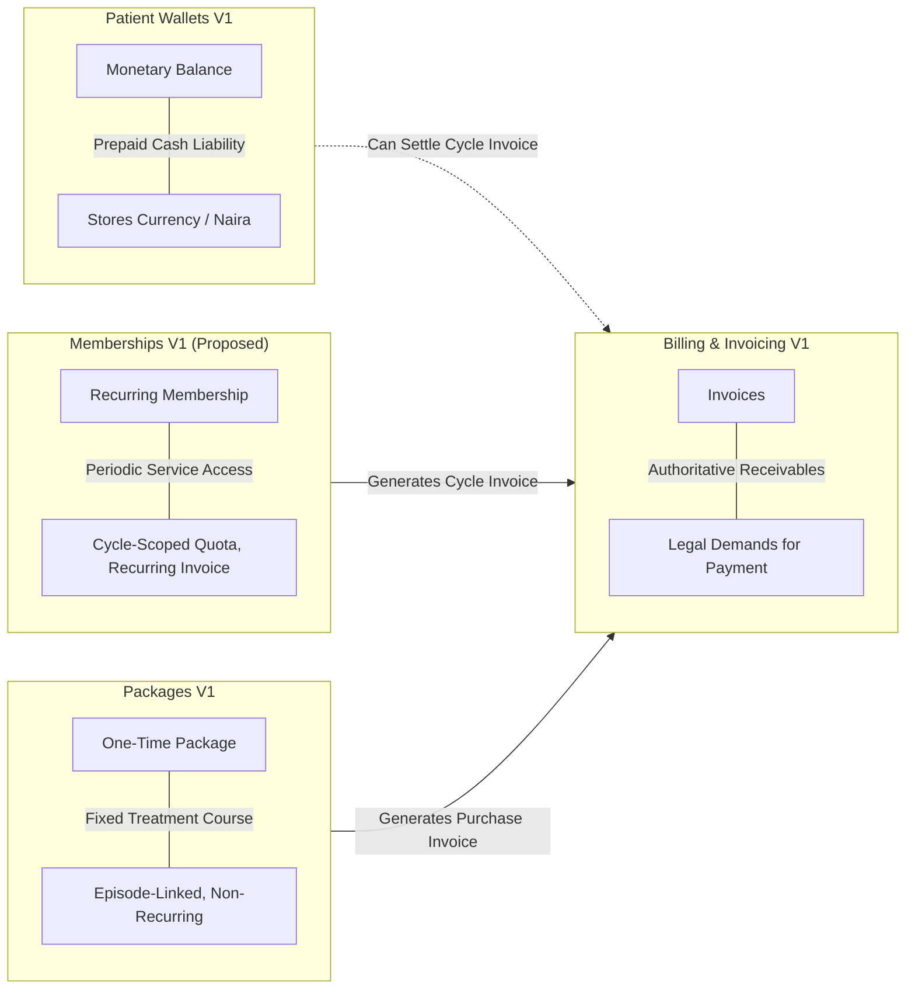
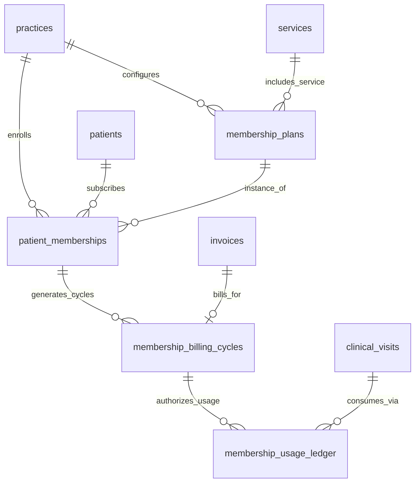
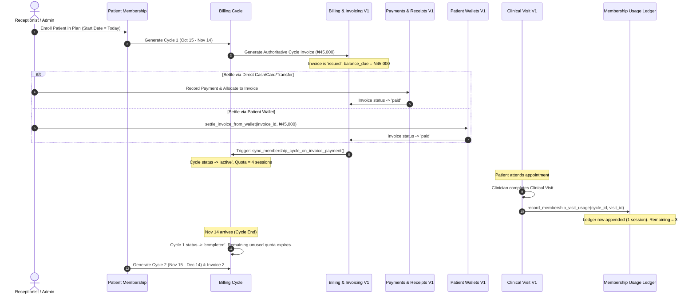
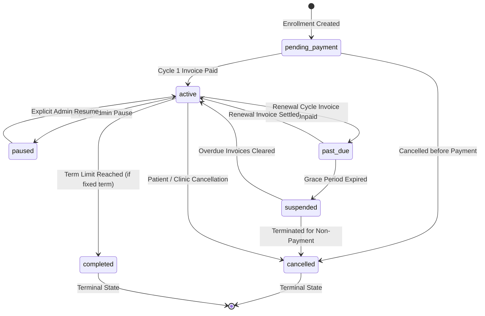
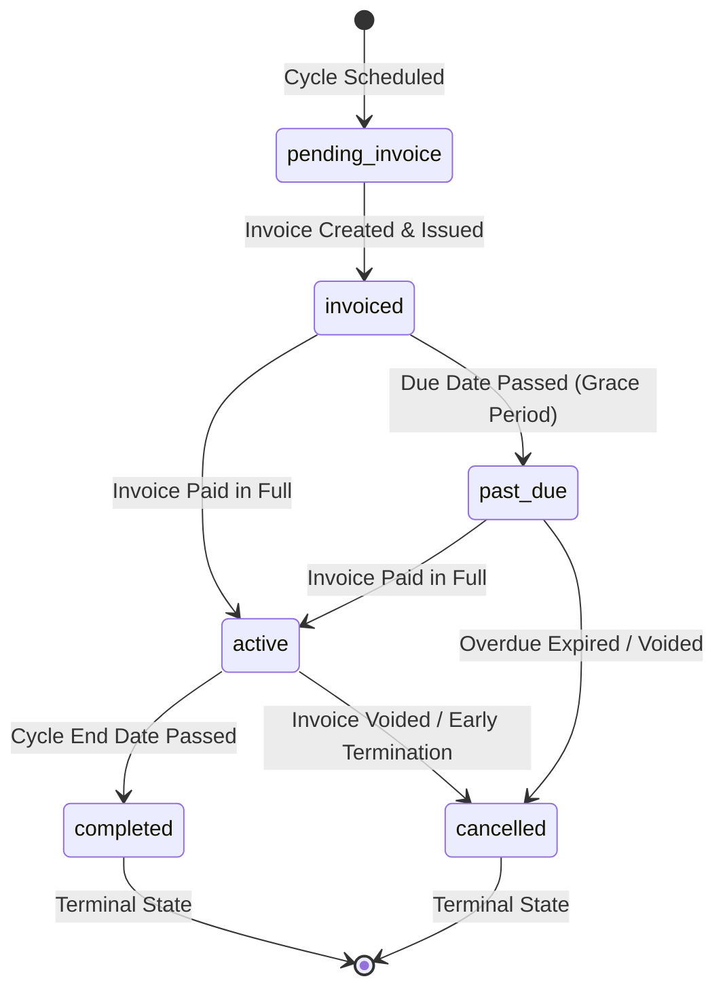
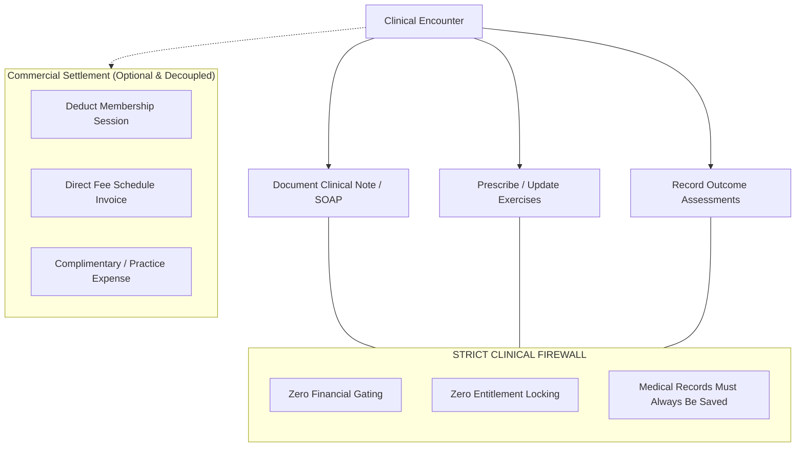
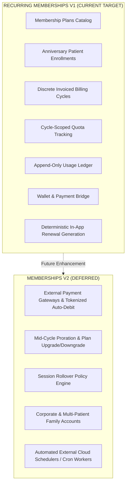

# PHYSENRA — RECURRING MEMBERSHIPS & SUBSCRIPTIONS V1
## Architecture Discovery & Security Gate Specification
### DISCOVERY ONLY — ZERO IMPLEMENTATION

---

### 1. EXECUTIVE SUMMARY

The Physenra Physiotherapy EMR & Practice Management Platform has established and verified its complete clinical continuum (Patient $\rightarrow$ Episode $\rightarrow$ Appointment $\rightarrow$ Visit $\rightarrow$ Clinical Note/SOAP $\rightarrow$ Outcome Measures $\rightarrow$ Home Exercise Program $\rightarrow$ Treatment Plan $\rightarrow$ Milestone & Progress Review $\rightarrow$ Discharge Summary) and its core commercial foundation:
$$\text{Service Catalog} \longrightarrow \text{Fee Schedule} \longrightarrow \text{Billing \& Invoicing} \longrightarrow \text{Payments \& Receipts} \longrightarrow \text{Packages V1} \longrightarrow \text{Patient Wallets V1}$$

Following the formal clearance and post-implementation security hardening of **Patient Wallets V1** (Commit `68a48262cff85701a94ad8c9797e6b59a297a7df`), the commercial roadmap explicitly arrives at the first formal architecture discovery for:
$$\mathbf{RECURRING\ MEMBERSHIPS\ \&\ SUBSCRIPTIONS\ V1}$$

In outpatient physiotherapy and musculoskeletal rehabilitation, clinics routinely establish ongoing care agreements with patients. Common clinical examples include:
- **Chronic Spine Care & Postural Maintenance**: ₦45,000 / month for 4 guided maintenance therapy sessions per month.
- **Post-Surgical / Post-Acute Conditioning**: ₦35,000 / month for 2 supervised exercise therapy sessions and continuous HEP updates.
- **Athletic Performance & Injury Prevention**: ₦120,000 / quarter for 12 sport-specific conditioning encounters.
- **Senior Mobility & Fall Prevention Club**: ₦30,000 / month for weekly group or individual balance conditioning.

Without an authoritative membership architecture, clinics attempt to manage these recurring commitments through informal calendar reminders, unlinked manual invoices, mutable spreadsheet counters, or by misusing one-time packages. This leads to billing leakage, expired sessions accumulating as unbounded practice liability, disputable invoices, clinical documentation blocks, and failure of financial auditability.

#### Core Discovery Determinations:
1. **Domain Definition (Contractual Periodic Service Entitlement Demand)**:
   - A **Membership** is an ongoing commercial and clinical contractual relationship between a practice and a patient, wherein the practice commits to providing a defined quota of clinical services within discrete recurring time windows (**Billing Cycles**) in exchange for a recurring cycle fee.
   - A membership is **NOT money** (it is not a wallet) and is **NOT a one-off bulk purchase** (it is not a package).
2. **Approved Architecture (Option E — Invoiced Billing-Cycle Demand + Decoupled Membership Enrollment + Cycle-Scoped Immutable Entitlement & Usage Ledger)**:
   - **Subscription Plan** (`membership_plans`): Practice-level catalog defining the recurring tariff, billing cadence (monthly/quarterly/annual), included service, and cycle quota.
   - **Membership Enrollment** (`patient_memberships`): Patient-level contract tracking lifecycle status (`pending_payment`, `active`, `paused`, `suspended`, `cancelled`, `completed`), anniversary billing anchor, and renewal policy. Zero mutable session balance columns!
   - **Membership Billing Cycle** (`membership_billing_cycles`): Authoritative representation of each discrete time window (e.g., Cycle 1: Oct 15 – Nov 14). Each cycle links directly to an authoritative accounts receivable invoice in `invoices`.
   - **Unified Invoicing & Payment Bridge**: Invoicing remains the single source of financial truth. Each cycle triggers the generation of an official Physenra invoice (`invoices` & `invoice_lines`), snapshotting current pricing. When the invoice is paid (via Cash, Card, Bank Transfer, or Patient Wallet settlement), the cycle status transitions to `active`.
   - **Cycle-Scoped Immutable Usage Ledger** (`membership_usage_ledger`): Append-only ledger recording clinical sessions consumed against the active cycle, linked to `clinical_visits` and `services`. Available quota is strictly derived:
     $$\text{Remaining Quota}_c = \text{cycle}_c.\text{session\_quota} - \sum_{e \in \text{Usage Ledger}(c)} e.\text{sessions\_consumed}$$
   - **Non-Accumulation Invariant (Zero Rollover in V1)**: Quota is strictly cycle-scoped. Unused sessions expire at cycle boundaries, eliminating unbounded clinic liability.
3. **Strict Domain Firewalls**:
   - **Clinical Firewall**: Clinical documentation (SOAP notes, HEP, outcome measures) is 100% independent of membership status. A physiotherapist is NEVER blocked from documenting clinical care due to an unpaid membership invoice, quota exhaustion, or membership suspension.
   - **Package Firewall**: Packages represent fixed one-off episode treatments; memberships represent periodic continuous wellness/maintenance agreements. Quotas and ledgers remain completely isolated.
   - **Wallet Firewall**: Wallets store fiat cash liability; memberships represent service usage rights. Patient wallets can be used to settle membership cycle invoices via `settle_invoice_from_wallet`, preserving 100% of wallet invariants with zero duplicate monetary creation.
   - **Deferred Domains**: External payment gateways (Stripe, Paystack, Flutterwave), automated card tokenization/vaulting, background cron daemons, mid-cycle proration, quota rollovers, and credit notes are strictly deferred from V1.
4. **Physical Isolation**: Complete physical and logical independence from external legacy systems is strictly maintained.

---

### 2. PRE-DISCOVERY AUDIT

An exhaustive verification of the Physenra codebase, local git repository, and remote Supabase project was conducted prior to formal discovery:

| Dimension | Verified State | Audit Evidence |
|---|---|---|
| **Repository Path** | `C:\project\physenra` | Local filesystem verified |
| **Active Branch** | `main` | `git status` confirmed `on branch main` |
| **HEAD Commit** | `68a48262cff85701a94ad8c9797e6b59a297a7df` | Verified via `git rev-parse HEAD` |
| **Commit Message** | `fix: harden Physenra patient wallet financial invariants` | Clean verified baseline |
| **Working Tree** | Clean | `git status` confirms 0 unstaged / 0 untracked files |
| **Remote Origin URL** | `https://github.com/physenra/physenra.git` | Verified via `git remote -v` (Strictly NOT pushed) |
| **Deployment State** | Local only | Strictly NOT deployed |
| **Supabase Project** | `xxknmdgneamtoahqayvl` | Live REST and Management API verified |
| **Public Database Tables** | 50 tables | Verified via `information_schema.tables` |
| **Row-Level Security (RLS)** | 100% coverage (50 / 50 tables) | Verified via `pg_class.relrowsecurity` (0 tables without RLS) |
| **Automated Test Suite** | 601 / 601 tests passing across 19 suites | Verified via `node --test tests/*.test.cjs` (0 failures, 0 skipped) |
| **Production Build** | 0 TypeScript / 0 Rollup errors | Verified via `npm.cmd run build` (built in 6.61s) |
| **Legacy Isolation** | 100% independent | Zero matches for legacy strings across all source files |

---

### 3. CURRENT COMMERCIAL DOMAIN INVENTORY

Physenra’s existing commercial architecture is structured as a series of authoritative, decoupled layers:

| Layer # | Domain Module | Primary Tables | Core Responsibility & Architectural Authority |
|:---:|:---|:---|:---|
| **1** | **Service Catalog** | `public.services` | Master definition of clinical services (name, code, standard duration, category). |
| **2** | **Fee Schedule** | `public.fee_schedules`, `public.fee_schedule_items` | Tariff pricing engine. Determines standard rates per service per practice and currency. |
| **3** | **Billing & Invoicing** | `public.invoices`, `public.invoice_lines`, `practice_invoice_counters` | Accounts receivable truth. Immutable grand totals, tax, line items, and payment status lifecycle (`draft`, `issued`, `partially_paid`, `paid`, `void`). |
| **4** | **Payments & Receipts** | `public.payments`, `public.receipts`, `public.payment_allocations` | Cash/inflow settlement truth. Records monetary tender, generates official receipts, and allocates funds to invoices. |
| **5** | **Packages V1** | `public.package_definitions`, `public.package_entitlements`, `public.package_consumption_ledger` | One-off fixed multi-session treatment packages. Activated by paid invoice; consumed by completed clinical visits. |
| **6** | **Patient Wallets V1** | `public.patient_wallets`, `public.patient_wallet_ledger`, `practice_wallet_counters` | Pre-funded patient credit accounts. Derived balance ($\sum \text{amount}$), non-negative invariant, pessimistic locking, unified settlement bridge. |

---

### 4. MEMBERSHIP DOMAIN DEFINITIONS

To prevent semantic conflation, the Recurring Memberships domain is decomposed into five discrete architectural concepts:

#### A. Subscription / Membership Plan (`membership_plans`)
The template catalog entity configured by clinic management. Defines what the practice offers:
- `plan_code`: Unique uppercase code within the practice (e.g., `PLAN-SPINE-M`, `PLAN-REHAB-Q`).
- `name`: Descriptive name (e.g., "Monthly Spine Care Maintenance").
- `description`: Scope of clinical maintenance included.
- `included_service_id`: Foreign key to `public.services`. The primary clinical service covered by the plan quota.
- `billing_frequency`: Cycle cadence enum: `'monthly'`, `'quarterly'`, `'annually'`.
- `cycle_price`: Fixed monetary fee per billing cycle.
- `currency`: ISO 4217 code (default `'NGN'`).
- `cycle_session_quota`: Number of included clinical sessions per billing cycle (e.g., 4 sessions/month).
- `status`: Plan status (`'active'`, `'archived'`).

#### B. Membership Enrollment (`patient_memberships`)
The contractual agreement between a specific patient and the practice for a specific plan:
- `membership_number`: Sequential human-readable identifier (`MBR-000001`).
- `patient_id`: Enrolled patient.
- `plan_id`: Subscribed plan.
- `start_date`: Date the membership agreement commences.
- `billing_anchor_day`: Day of month (1–28) on which recurring cycles anchor.
- `status`: Enrollment lifecycle state (`'pending_payment'`, `'active'`, `'paused'`, `'suspended'`, `'cancelled'`, `'completed'`).
- `auto_renew`: Boolean flag indicating whether the clinic intends to generate renewal cycles.
- `cancellation_reason`: Mandatory justification if cancelled.
- `paused_at`, `resumed_at`: Pause audit timestamps.

#### C. Billing Cycle (`membership_billing_cycles`)
A discrete, bounded time interval representing one term of the membership (e.g., Cycle 1: Oct 15 – Nov 14):
- `cycle_number`: Sequential cycle index for the enrollment (1, 2, 3...).
- `cycle_start_date`: Inclusive start date.
- `cycle_end_date`: Inclusive end date.
- `billing_date`: Date the cycle fee is billed / due.
- `invoice_id`: Pointer to the authoritative accounts receivable record in `public.invoices`.
- `cycle_price`: Snapshot of price charged for this cycle.
- `session_quota`: Snapshot of session quota granted for this cycle (e.g., 4 sessions).
- `status`: Cycle state (`'pending_invoice'`, `'invoiced'`, `'active'`, `'past_due'`, `'completed'`, `'cancelled'`).

#### D. Membership Entitlement
The legal and operational right of the patient to receive clinical services within the active billing cycle:
- Entitlement is **NOT a global account balance**.
- Entitlement is **strictly cycle-scoped**. A patient has entitlement if and only if they have a billing cycle with `status = 'active'` covering the current date, with remaining session quota $> 0$.

#### E. Membership Usage (`membership_usage_ledger`)
The immutable record of clinical service consumption against a specific billing cycle:
- Links the consumption event directly to an executed `clinical_visits` encounter.
- Append-only. Records `sessions_consumed` (typically 1.0).
- Contains zero mutable columns.

---

### 5. CONCEPTUAL BOUNDARIES & INVARIANTS

To protect financial and clinical integrity, the architecture enforces rigid conceptual firewalls:



#### Strict Non-Negotiable Invariants:
1. **Membership $\neq$ Wallet**: A wallet holds stored currency (₦); a membership grants time-bounded treatment rights. A membership must never become a disguised mutable cash balance.
2. **Membership $\neq$ Package**: A package is a one-off purchase of $N$ sessions for an acute episode of care (e.g., 10 post-ACL reconstruction sessions). A membership is a continuous, recurring maintenance agreement with time-expiring cycle quotas.
3. **Membership $\neq$ Invoice**: A membership does not replace an invoice. Every billing cycle creates an official Physenra invoice. Accounts receivable truth remains 100% inside `invoices`.
4. **Membership $\neq$ Payment**: Enrolling in a membership is not a payment. Inflows are recorded in `payments`.
5. **Membership Quota $\neq$ Stored Money**: Quotas represent service access slots, not redeemable cash. Unused sessions have zero cash refund value.
6. **Clinical Visit $\neq$ Membership Consumption**: Clinical documentation is a medical record; membership consumption is a billing settlement. A clinician documents care regardless of whether a membership is active, past due, or exhausted.

---

### 6. ARCHITECTURE OPTIONS EVALUATED

Five distinct architectural approaches were evaluated against Physenra’s foundational design principles:

#### OPTION A: Mutable Membership Balance / Counter
- **Description**: Add `sessions_remaining INT` and `cycle_end DATE` directly to `patient_memberships`. When a patient attends a visit, update `sessions_remaining = sessions_remaining - 1`. When a cycle renews, update `sessions_remaining = 4`.
- **Database**: Single table with mutable columns.
- **Evaluation**:
  - *Pros*: Simple initial schema.
  - *Cons*: **Fatal architectural defect**. Destroys historical auditability. Concurrency race conditions permit double-spending. Balance changes cannot be reconciled against clinical visits or financial invoices. Completely contradicts Physenra’s established immutable ledger pattern.
  - *Verdict*: **REJECTED**.

#### OPTION B: Membership Implemented Purely Through Recurring Invoices & Notes
- **Description**: Do not create membership tables. Have an automated script create an invoice each month. When a visit occurs, check if an invoice was paid in the last 30 days.
- **Database**: Zero new tables.
- **Evaluation**:
  - *Pros*: Zero schema expansion.
  - *Cons*: Conflates billing demand with clinical service entitlement. Cannot track per-cycle quota consumption (e.g., how many of the 4 sessions were used). Cannot support pause, suspension, grace periods, or visit linkage.
  - *Verdict*: **REJECTED**.

#### OPTION C: Subscription Plan + Membership Enrollment + Billing Cycle Records + Immutable Entitlement/Usage Ledger
- **Description**: Decouple catalog plans, patient enrollments, discrete time-bounded billing cycles, and append-only usage logs.
- **Database**: 4 normalized tables (`membership_plans`, `patient_memberships`, `membership_billing_cycles`, `membership_usage_ledger`).
- **Evaluation**:
  - *Pros*: Complete audit trail, zero mutable quota columns, cycle-scoped entitlement, immutable clinical visit linkage.
  - *Cons*: Requires rigorous state synchronization between invoices, cycles, and usage.
  - *Verdict*: **STRONG CANDIDATE** (Basis for Option E).

#### OPTION D: Unified Package + Membership Product Model
- **Description**: Merge Packages V1 and Memberships into a single "products" and "entitlements" schema. Add a boolean `is_recurring` to `package_definitions`.
- **Database**: Mutate existing `package_definitions` and `package_entitlements`.
- **Evaluation**:
  - *Pros*: Reuses existing package consumption tables.
  - *Cons*: **Violates domain boundaries and introduces schema pollution**. Treatment packages have fixed validity, single invoices, and acute care linkage. Memberships have recurring cycles, billing anchors, anniversary renewals, pause states, and cycle-expiring quotas. Forcing them together creates nullable columns, complex conditional checks, and threatens already verified Packages V1 stability.
  - *Verdict*: **REJECTED**.

#### OPTION E (RECOMMENDED): Invoiced Billing-Cycle Demand + Decoupled Membership Enrollment + Cycle-Scoped Immutable Entitlement & Usage Ledger
- **Description**: Refines Option C by formalizing the **Unified Invoicing & Settlement Bridge**:
  1. Every billing cycle creates an authoritative invoice in `public.invoices`.
  2. The cycle acts as the bridge between billing receivables and clinical service entitlement.
  3. Cycle entitlement is activated only upon invoice payment (or controlled grace period).
  4. Quota is strictly cycle-scoped and derived from an append-only ledger (`membership_usage_ledger`).
  5. Unused quota expires at cycle boundaries (zero rollover in V1).
  6. Cancellations remain active until the end of the paid cycle (no mid-cycle proration complexity).
- **Verdict**: **ACCEPTED AS THE FORMAL ARCHITECTURE**.

---

### 7. DETAILED ARCHITECTURAL COMPARISON MATRIX

| Evaluation Criterion | Option A (Mutable) | Option B (Invoice Only) | Option C (Decoupled Ledger) | Option D (Unified Pkg/Mbr) | Option E (Recommended) |
|---|:---:|:---:|:---:|:---:|:---:|
| **Zero Mutable Balance Invariant** | ❌ Fails | ⚠️ N/A | ✅ Satisfied | ⚠️ Partial | ✅ **Strictly Satisfied** |
| **Immutable Clinical Visit Linkage** | ❌ None | ❌ None | ✅ Complete | ⚠️ Complex | ✅ **Complete & Exact** |
| **Accounts Receivable Integrity** | ❌ Disconnected | ⚠️ High Coupling | ✅ Preserved | ⚠️ Conflicted | ✅ **Single-Source Truth** |
| **Pessimistic Concurrency Safety** | ❌ High Race Risk | ⚠️ Poor | ✅ Row Locking | ⚠️ High Conflict | ✅ **Strict Row Locking** |
| **Packages V1 Isolation** | ✅ Isolated | ✅ Isolated | ✅ Isolated | ❌ Contaminated | ✅ **Strictly Firewalled** |
| **Wallet V1 Settlement Bridge** | ❌ Broken | ⚠️ Manual | ✅ Compatible | ⚠️ Complex | ✅ **Seamless & Verified** |
| **Historical Price Snapshots** | ❌ Lost | ✅ In Invoices | ✅ In Cycles/Invoices | ⚠️ Fragile | ✅ **Double-Protected** |
| **Non-Accumulation (Zero Rollover)**| ❌ Fails | ❌ Uncontrolled | ✅ Explicit | ⚠️ Cluttered | ✅ **Cycle-Expiring Invariant**|
| **Proration Risk Mitigation** | ❌ Chaotic | ❌ Not handled | ⚠️ Complex | ❌ High Risk | ✅ **Anniversary (Deferred)** |
| **Clinical Documentation Firewall**| ❌ Coupled | ❌ Coupled | ✅ Firewalled | ⚠️ Mixed | ✅ **100% Decoupled** |
| **Implementation Complexity** | Low (Dangerous) | Low (Incomplete) | Medium | Very High | **Balanced & Robust** |

---

### 8. SELECTED ARCHITECTURE SPECIFICATION (OPTION E)



#### Complete Operational Lifecycle Flow:


---

### 9. BILLING & INVOICING DEPENDENCY ANALYSIS

The interaction between Recurring Memberships and Billing & Invoicing V1 must strictly adhere to existing billing invariants:
1. **Invoice Authority**: The membership domain does **NOT** manage debtor balances, taxes, or payments. Each billing cycle generates an official record in `public.invoices` and line item in `public.invoice_lines`.
2. **Timing of Invoice Creation**:
   - For Cycle 1 (Enrollment): The invoice is generated immediately upon enrollment.
   - For Subsequent Renewal Cycles: The invoice is generated on the cycle's `billing_date` (e.g., 3–5 days prior to `cycle_start_date` to allow timely settlement).
3. **Price Snapshotting**:
   - `invoice_lines` snapshots `unit_price = plan.cycle_price` at the moment of invoice generation.
   - Subsequent changes to `membership_plans.cycle_price` do **NOT** retroactively mutate existing invoices or existing active cycles.
4. **Partially Paid Invoices**:
   - If an invoice is only partially paid, the cycle remains in `past_due` or `pending_invoice`. Quota is **NOT** activated until full settlement, unless an explicit practice-configured grace period is active.
5. **Invoice Voiding**:
   - If an invoice associated with an active cycle is voided:
     - The cycle transitions to `cancelled` or `suspended`.
     - Future usage against that cycle is blocked.
     - Any sessions already consumed remain immutably recorded in `membership_usage_ledger` with an audit flag indicating invoice voidance.

---

### 10. PAYMENTS & RECEIPTS DEPENDENCY ANALYSIS

1. **Inflow Settlement**: Payment for a membership cycle is executed entirely through existing Payments V1 stored procedures (`record_payment_and_allocate` or `settle_invoice_from_wallet`).
2. **Official Legal Receipt**: Settling a cycle invoice generates an authoritative record in `public.receipts`.
3. **Payment Void Reversal**:
   - If a payment that settled a cycle invoice is subsequently voided via `public.void_payment`:
     - The invoice balance reverts to `balance_due > 0` (status `partially_paid` or `issued`).
     - A database trigger detects this invoice state reversal and transitions the linked billing cycle to `past_due` or `suspended`.
     - Active entitlement is paused until the debt is re-settled.

---

### 11. PATIENT WALLET DEPENDENCY ANALYSIS

The relationship between Patient Wallets V1 and Recurring Memberships V1 is strictly one-way and non-conflicting:
1. **Wallet as a Tender Method**: If a patient has pre-funded their wallet (e.g., ₦100,000 credit), the practice can settle the membership cycle invoice (e.g., ₦45,000) using `public.settle_invoice_from_wallet(...)`.
2. **Preservation of Wallet Invariants**:
   - The wallet balance decreases by ₦45,000 via an immutable `invoice_settlement` ledger entry.
   - The invoice balance becomes 0.00 (`status = 'paid'`).
   - The billing cycle detects full payment and activates entitlement.
   - **Zero Duplicate Value**: Money moves from customer deposit liability $\rightarrow$ earned revenue. Zero fictitious credit is created.
3. **Insufficient Wallet Funds**: If wallet balance is insufficient, `settle_invoice_from_wallet` safely rolls back. The invoice remains unpaid and the cycle is not activated.

---

### 12. ONE-TIME PACKAGES DEPENDENCY ANALYSIS

Memberships and Packages coexist without mutual contamination:
1. **Independent Coexistence**: A patient may simultaneously hold an active Post-Op Knee Package (for an acute episode) and a Monthly Wellness Membership (for ongoing chronic maintenance).
2. **Zero Quota Bleed**:
   - Membership sessions **cannot** be used to satisfy package consumption.
   - Package sessions **cannot** be consumed against a membership cycle.
   - Separate ledger tables (`package_consumption_ledger` vs `membership_usage_ledger`) prevent accidental aggregation.
3. **Clinical Disambiguation**: When recording visit settlement, the UI and service layer require explicit selection of whether the encounter is covered by "Package", "Membership", or "Direct Invoicing".

---

### 13. LIFECYCLE STATE MACHINE

#### A. Patient Membership Enrollment State Machine


| Transition | Trigger | Pre-Conditions | Database Authority | Audit Event |
|---|---|---|---|---|
| `[*] -> pending_payment` | `enroll_patient_in_membership` | Patient exists, Plan is active | RPC Insert | `membership.enrolled` |
| `pending_payment -> active` | Cycle 1 Invoice Marked Paid | Invoice `balance_due = 0` | Trigger / RPC | `membership.activated` |
| `active -> paused` | `pause_patient_membership` | Reason $\ge 10$ chars, active cycle handled | RPC Update | `membership.paused` |
| `paused -> active` | `resume_patient_membership` | Reason $\ge 10$ chars | RPC Update | `membership.resumed` |
| `active -> past_due` | Renewal Invoice Issued & Due | Cycle billing date passed | Trigger / RPC | `membership.past_due` |
| `past_due -> suspended` | Grace Period Expired | Overdue $> 7$ days | Trigger / RPC | `membership.suspended` |
| `active/past_due -> cancelled` | `cancel_patient_membership` | Reason $\ge 10$ chars | RPC Update | `membership.cancelled` |

#### B. Membership Billing Cycle State Machine


---

### 14. RENEWAL MODEL SPECIFICATION

1. **V1 Renewal Mechanism (Deterministic Systematic Generation)**:
   - To avoid premature complexity with external cron runners, queue daemons, or webhook infrastructure in V1, recurring renewal cycle generation is architected as an **idempotent, deterministic database procedure**:
     `public.generate_membership_renewal_cycles(p_practice_id UUID)`
   - Can be triggered on-demand by administrative staff (e.g., "Generate Monthly Billing Demands" button on the Memberships dashboard) or invoked by a lightweight scheduled worker.
2. **Anniversary Billing Anchor**:
   - Each enrollment records `billing_anchor_day` based on the start date (e.g., enrolled Oct 18 $\rightarrow$ anchor day is 18).
   - Cycle 1: Oct 18 – Nov 17.
   - Cycle 2: Nov 18 – Dec 17.
   - Eliminates end-of-month calendar compression and spikes in clinic administrative workload.
3. **Renewal Invoice Generation Window**:
   - Renewal cycle and invoice are generated 3 days prior to `cycle_start_date`.
   - Allows patients and staff to settle the cycle invoice prior to the commencement of the new entitlement period.
4. **Renewal Failure & Grace Period**:
   - If the renewal invoice is not paid by `cycle_start_date`, the cycle enters `past_due`.
   - **V1 Grace Period Invariant**: Configurable grace period (default 5 days). During the grace period, members may continue to utilize quota. If unpaid after grace expiry, status transitions to `suspended`, blocking further session deductions until settled.

---

### 15. QUOTA & CONSUMPTION MODEL

1. **Cycle-Scoped Quota**:
   - Quota belongs strictly to a specific `membership_billing_cycles` row.
   - Example: 4 sessions granted for Cycle 1 (Oct 18 – Nov 17).
2. **Mathematical Derived Remaining Quota**:
   - `membership_billing_cycles` contains `session_quota INT NOT NULL`.
   - It contains **zero mutable remaining balance column**.
   - Remaining quota is calculated deterministically:
     $$\text{Remaining Quota} = \text{session\_quota} - \sum_{e \in \text{Usage Ledger}} e.\text{sessions\_consumed}$$
3. **Usage Recording Invariant**:
   - Executing `record_membership_visit_usage`:
     - Verifies cycle is `active` (or `past_due` within grace period).
     - Verifies `current_date BETWEEN cycle_start_date AND cycle_end_date`.
     - Verifies `Remaining Quota \ge 1`.
     - Appends row to `membership_usage_ledger`.
     - Guarantees post-usage `Remaining Quota \ge 0`.
4. **Non-Accumulation & Expiration (Zero Rollover in V1)**:
   - When a billing cycle reaches `cycle_end_date`, any unconsumed quota expires immediately.
   - Unused sessions do **NOT** roll over into subsequent cycles.
   - *Rationale*: Allowing unused sessions to accumulate transforms the clinic’s membership into an open-ended treatment liability, creating major staffing bottlenecks and financial distortive accruals. Rollover is explicitly deferred to V2.

---

### 16. PRICING & HISTORICAL INTEGRITY

1. **Double Price Protection**:
   - `membership_billing_cycles.cycle_price` records the agreed fee at the time the cycle was established.
   - `invoices` and `invoice_lines` freeze `unit_price`, `subtotal`, and `grand_total` upon issuance.
2. **Plan Price Evolution**:
   - If clinic management updates `membership_plans.cycle_price` (e.g., from ₦40,000 to ₦45,000/month):
     - The update applies only to new enrollments or future ungenerated cycles.
     - All previously generated cycles and existing invoices remain completely immutable.
3. **Currency Immutability**:
   - Plans, enrollments, cycles, and invoices must share matching ISO currency (`NGN`).
   - Cross-currency memberships are strictly rejected.

---

### 17. PRORATION DECISION: EXPLICITLY DEFERRED

#### Evaluation of Proration:
- Proration involves calculating partial monetary charges or partial session allocations when a patient joins mid-cycle, cancels mid-cycle, or pauses.
- In outpatient healthcare, proration creates severe accounting distortions:
  - Fractional day calculations produce fractional Naira currency amounts (e.g., ₦14,354.84), complicating cash receipts and tax accounting.
  - Fractional session quotas (e.g., 2.3 sessions) cannot be clinically delivered (a physiotherapy session is an indivisible clinical encounter).

#### Approved V1 Strategy:
- **Mid-Cycle Joins**: Solved cleanly via the **Anniversary Billing Anchor**. A patient joining on October 23 begins Cycle 1 on October 23. There is no mid-cycle join; every join is the beginning of a fresh 30-day cycle.
- **Mid-Cycle Cancellations**: When a patient cancels an active membership, the cancellation takes effect at the **end of the current paid billing cycle**. The patient retains access to their remaining cycle quota through `cycle_end_date`. Zero partial cash refunds are issued.
- **Mid-Cycle Upgrades/Downgrades**: Deferred to V2. Upgrades/downgrades take effect upon the next cycle renewal.
- **Decision**: **PRORATION IS STRICTLY DEFERRED IN V1**.

---

### 18. CONCURRENCY & IDEMPOTENCY

To prevent race conditions, duplicate billing, and over-consumption under high concurrency:
1. **Row-Level Locking (`FOR UPDATE`)**:
   - Cycle generation locks `patient_memberships` `FOR UPDATE`.
   - Usage deduction locks `membership_billing_cycles` `FOR UPDATE` before evaluating remaining quota.
2. **Database Unique Constraints**:
   - `UNIQUE (membership_id, cycle_number)` on `membership_billing_cycles`.
   - `UNIQUE (membership_id, cycle_start_date)` preventing overlapping cycles.
   - `UNIQUE (cycle_id, clinical_visit_id)` on `membership_usage_ledger` preventing duplicate session deduction for the same clinical encounter.
   - `UNIQUE (practice_id, idempotency_key)` across all financial and usage procedures.

---

### 19. SECURITY THREAT MODEL & MITIGATIONS

| # | Threat Vector | Attack Path | Mitigation & Database Enforcement |
|:---:|:---|:---|:---|
| **T1** | **Cross-Tenant Access** | Malicious tenant accesses another practice's memberships | Tenant-isolated composite foreign keys `(id, practice_id)` on all tables; strict RLS `practice_id = current_practice_id()`. |
| **T2** | **Duplicate Cycle Invoicing** | Rapid concurrent calls trigger duplicate invoices for one cycle | Unique constraint on `(membership_id, cycle_number)`; RPC locks membership header `FOR UPDATE`. |
| **T3** | **Quota Over-Consumption** | Simultaneous requests deduct sessions exceeding cycle quota | Pessimistic lock `SELECT ... FROM membership_billing_cycles WHERE id = p_cycle_id FOR UPDATE`; strict post-check `Remaining Quota >= 0`. |
| **T4** | **Reopening Cancelled Agreements** | User attempts to reactivate a cancelled membership | Immutability trigger on `patient_memberships` strictly rejects transitions from `cancelled` or `completed`. |
| **T5** | **Double-Deduction of Visit** | Multiple staff click "Deduct Membership Session" for one visit | Unique constraint `uq_usage_cycle_visit UNIQUE (cycle_id, clinical_visit_id)` strictly rejects duplicate deduction. |
| **T6** | **Unearned Entitlement Activation**| Cycle activated without payment | Trigger on `invoices` ensures cycle only transitions to `active` when invoice `balance_due = 0.00` and `status = 'paid'`. |
| **T7** | **PostgREST Dual-Path Ambiguity** | Ambiguous relations to `practices` and `profiles` | Explicit constraint names (`fk_mbr_patient_practice`, etc.) and mandatory PostgREST disambiguation hints. |
| **T8** | **Privilege Escalation** | Receptionist archives plans or overrides pricing | RBAC in RPCs: Plan modification restricted strictly to `practice_owner` and `practice_manager`. |

---

### 20. ROW-LEVEL SECURITY (RLS) & RBAC SPECIFICATION

All proposed tables will enforce Row-Level Security:

| Role | `membership_plans` | `patient_memberships` | `membership_billing_cycles` | `membership_usage_ledger` |
|---|:---:|:---:|:---:|:---:|
| **Practice Owner** | Full Access (CRUD) | Full Access (CRUD) | Full Access (CRUD) | Full Access (Create / View) |
| **Practice Manager** | Full Access (CRUD) | Full Access (CRUD) | Full Access (CRUD) | Full Access (Create / View) |
| **Accountant** | View Only | View / Update Billing | View / Manage Invoices | View Only |
| **Receptionist** | View Only | Create / View Enroll | View Cycles / Invoices | Record Usage / View |
| **Physiotherapist** | View Only | View Only | View Entitlement Only | Record Usage / View |
| **Patient** | View Active Plans | View Own Memberships | View Own Cycles | View Own Usage |
| **Platform Admin** | Denied (No Tenant) | Denied (No Tenant) | Denied (No Tenant) | Denied (No Tenant) |

---

### 21. POSTGREST RELATIONSHIP STRATEGY

To maintain Physenra’s zero-ambiguity PostgREST architecture, all proposed tables will feature explicit multi-tenant composite foreign keys and corresponding constraint hints:

| Resource Path | Required PostgREST Embed Hint | Disambiguated Target |
|---|---|---|
| `membership_plans` $\rightarrow$ `services` | `service:services!fk_plan_service_practice(...)` | Included service details |
| `patient_memberships` $\rightarrow$ `patients` | `patient:patients!fk_membership_patient_practice(...)` | Enrolled patient demographics |
| `patient_memberships` $\rightarrow$ `membership_plans` | `plan:membership_plans!fk_membership_plan_practice(...)` | Subscribed plan details |
| `membership_billing_cycles` $\rightarrow$ `invoices` | `invoice:invoices!fk_cycle_invoice_practice(...)` | Linked cycle invoice |
| `membership_usage_ledger` $\rightarrow$ `clinical_visits` | `visit:clinical_visits!fk_usage_visit_practice(...)` | Consuming clinical encounter |

---

### 22. AUDIT EVENTS TAXONOMY

Every significant membership transition must record an immutable audit event via `public.log_audit_event`:
- `membership.plan_created`: New plan configured in catalog.
- `membership.plan_updated`: Plan details or pricing updated.
- `membership.enrolled`: Patient enrolled in membership.
- `membership.cycle_generated`: New billing cycle and invoice generated.
- `membership.cycle_activated`: Cycle invoice paid and entitlement activated.
- `membership.usage_recorded`: Session deducted for clinical visit.
- `membership.paused`: Membership paused by administration.
- `membership.resumed`: Membership resumed from pause.
- `membership.suspended`: Membership suspended due to non-payment.
- `membership.cancelled`: Membership cancelled with recorded reason.

---

### 23. CLINICAL DOCUMENTATION FIREWALL



1. **Non-Blocking Care**: A physiotherapist documenting a SOAP note or updating an exercise program is **NEVER** prompted with a billing modal or blocked because a membership is expired, suspended, or exhausted.
2. **Administrative Separation**: If a member's quota is exhausted, the visit is simply documented as normal. The encounter is subsequently billed as an out-of-quota standard fee-schedule visit or reviewed by billing staff.

---

### 24. DOMAIN FIREWALL & DEFERRED SCOPE

To ensure strict engineering control, the following domains are formally **EXCLUDED** from Recurring Memberships V1:
- ❌ **External Payment Gateways (Stripe / Paystack / Flutterwave)**: Deferred to Payments V2 / Gateways V1.
- ❌ **Automated Card Vaulting & Tokenization**: Deferred.
- ❌ **Automated Background Cron Daemons**: Deferred. Renewal generation is in-app systematic RPC.
- ❌ **Mid-Cycle Proration & Fractional Days**: Deferred. Handled via anniversary billing anchors.
- ❌ **Quota Rollover Across Cycles**: Deferred to V2.
- ❌ **Corporate / Multi-Patient Family Shared Memberships**: Deferred. V1 is strictly single-patient.
- ❌ **Credit Notes & Cash Refunds**: Deferred.

---

### 25. FUTURE COMPATIBILITY PATHWAYS

The Option E architecture guarantees forward compatibility without schema redesign:
1. **Gateways V1 Integration**: When payment gateways are introduced, webhook handlers will simply call `public.record_payment_and_allocate` for the cycle invoice, automatically triggering cycle activation.
2. **Rollover V2 Integration**: A future rollover policy column can be added to `membership_plans`. The cycle expiration RPC will simply calculate $\min(\text{unused}, \text{max\_rollover})$ and add it to the next cycle's quota.
3. **Proration V2 Integration**: Mid-cycle upgrade/downgrade calculation procedures can be added without altering the core cycle or usage ledger tables.

---

### 26. PROPOSED DATABASE BLUEPRINT (DISCOVERY ONLY — DO NOT IMPLEMENT)

```sql
-- 1. ENUMS
CREATE TYPE public.membership_frequency AS ENUM ('monthly', 'quarterly', 'annually');
CREATE TYPE public.membership_status AS ENUM ('pending_payment', 'active', 'paused', 'suspended', 'cancelled', 'completed');
CREATE TYPE public.membership_cycle_status AS ENUM ('pending_invoice', 'invoiced', 'active', 'past_due', 'completed', 'cancelled');

-- 2. PRACTICE MEMBERSHIP COUNTERS
CREATE TABLE IF NOT EXISTS public.practice_membership_counters (
    practice_id UUID PRIMARY KEY REFERENCES public.practices(id) ON DELETE CASCADE,
    last_number INTEGER NOT NULL DEFAULT 0,
    updated_at TIMESTAMPTZ NOT NULL DEFAULT now(),
    CONSTRAINT chk_practice_membership_counters_nonneg CHECK (last_number >= 0)
);

-- 3. MEMBERSHIP PLANS
CREATE TABLE IF NOT EXISTS public.membership_plans (
    id UUID PRIMARY KEY DEFAULT gen_random_uuid(),
    practice_id UUID NOT NULL REFERENCES public.practices(id) ON DELETE CASCADE,
    plan_code VARCHAR(32) NOT NULL,
    name VARCHAR(150) NOT NULL,
    description TEXT NULL,
    included_service_id UUID NOT NULL,
    billing_frequency public.membership_frequency NOT NULL DEFAULT 'monthly',
    cycle_price NUMERIC(12, 2) NOT NULL,
    currency VARCHAR(3) NOT NULL DEFAULT 'NGN',
    cycle_session_quota INTEGER NOT NULL,
    status VARCHAR(20) NOT NULL DEFAULT 'active',
    created_by UUID NOT NULL REFERENCES public.profiles(id),
    created_at TIMESTAMPTZ NOT NULL DEFAULT now(),
    updated_at TIMESTAMPTZ NOT NULL DEFAULT now(),
    CONSTRAINT uq_membership_plans_code UNIQUE (practice_id, plan_code),
    CONSTRAINT chk_membership_plans_price CHECK (cycle_price > 0.00),
    CONSTRAINT chk_membership_plans_quota CHECK (cycle_session_quota > 0),
    CONSTRAINT fk_plan_service_practice FOREIGN KEY (included_service_id, practice_id)
        REFERENCES public.services(id, practice_id) ON DELETE RESTRICT
);

-- 4. PATIENT MEMBERSHIPS
CREATE TABLE IF NOT EXISTS public.patient_memberships (
    id UUID PRIMARY KEY DEFAULT gen_random_uuid(),
    practice_id UUID NOT NULL REFERENCES public.practices(id) ON DELETE CASCADE,
    membership_number VARCHAR(32) NOT NULL,
    patient_id UUID NOT NULL,
    plan_id UUID NOT NULL,
    start_date DATE NOT NULL,
    billing_anchor_day INTEGER NOT NULL,
    status public.membership_status NOT NULL DEFAULT 'pending_payment',
    auto_renew BOOLEAN NOT NULL DEFAULT true,
    paused_at TIMESTAMPTZ NULL,
    resumed_at TIMESTAMPTZ NULL,
    cancelled_at TIMESTAMPTZ NULL,
    cancellation_reason TEXT NULL,
    created_by UUID NOT NULL REFERENCES public.profiles(id),
    created_at TIMESTAMPTZ NOT NULL DEFAULT now(),
    updated_at TIMESTAMPTZ NOT NULL DEFAULT now(),
    CONSTRAINT uq_patient_memberships_number UNIQUE (practice_id, membership_number),
    CONSTRAINT chk_membership_anchor_day CHECK (billing_anchor_day BETWEEN 1 AND 28),
    CONSTRAINT fk_membership_patient_practice FOREIGN KEY (patient_id, practice_id)
        REFERENCES public.patients(id, practice_id) ON DELETE RESTRICT,
    CONSTRAINT fk_membership_plan_practice FOREIGN KEY (plan_id, practice_id)
        REFERENCES public.membership_plans(id, practice_id) ON DELETE RESTRICT
);

-- 5. MEMBERSHIP BILLING CYCLES
CREATE TABLE IF NOT EXISTS public.membership_billing_cycles (
    id UUID PRIMARY KEY DEFAULT gen_random_uuid(),
    practice_id UUID NOT NULL REFERENCES public.practices(id) ON DELETE CASCADE,
    membership_id UUID NOT NULL,
    cycle_number INTEGER NOT NULL,
    cycle_start_date DATE NOT NULL,
    cycle_end_date DATE NOT NULL,
    billing_date DATE NOT NULL,
    invoice_id UUID NULL,
    cycle_price NUMERIC(12, 2) NOT NULL,
    session_quota INTEGER NOT NULL,
    status public.membership_cycle_status NOT NULL DEFAULT 'pending_invoice',
    created_at TIMESTAMPTZ NOT NULL DEFAULT now(),
    updated_at TIMESTAMPTZ NOT NULL DEFAULT now(),
    CONSTRAINT uq_cycle_membership_number UNIQUE (membership_id, cycle_number),
    CONSTRAINT chk_cycle_dates CHECK (cycle_end_date >= cycle_start_date),
    CONSTRAINT fk_cycle_membership_practice FOREIGN KEY (membership_id, practice_id)
        REFERENCES public.patient_memberships(id, practice_id) ON DELETE CASCADE,
    CONSTRAINT fk_cycle_invoice_practice FOREIGN KEY (invoice_id, practice_id)
        REFERENCES public.invoices(id, practice_id) ON DELETE RESTRICT
);

-- 6. MEMBERSHIP USAGE LEDGER (IMMUTABLE APPEND-ONLY)
CREATE TABLE IF NOT EXISTS public.membership_usage_ledger (
    id UUID PRIMARY KEY DEFAULT gen_random_uuid(),
    practice_id UUID NOT NULL REFERENCES public.practices(id) ON DELETE CASCADE,
    cycle_id UUID NOT NULL,
    membership_id UUID NOT NULL,
    patient_id UUID NOT NULL,
    clinical_visit_id UUID NOT NULL,
    service_id UUID NOT NULL,
    sessions_consumed NUMERIC(4, 2) NOT NULL DEFAULT 1.00,
    recorded_by UUID NOT NULL REFERENCES public.profiles(id),
    created_at TIMESTAMPTZ NOT NULL DEFAULT now(),
    CONSTRAINT uq_usage_cycle_visit UNIQUE (cycle_id, clinical_visit_id),
    CONSTRAINT chk_usage_consumed_positive CHECK (sessions_consumed > 0.00),
    CONSTRAINT fk_usage_cycle_practice FOREIGN KEY (cycle_id, practice_id)
        REFERENCES public.membership_billing_cycles(id, practice_id) ON DELETE RESTRICT,
    CONSTRAINT fk_usage_visit_practice FOREIGN KEY (clinical_visit_id, practice_id)
        REFERENCES public.clinical_visits(id, practice_id) ON DELETE RESTRICT
);
```

---

### 27. PROPOSED SERVICE BLUEPRINT (DISCOVERY ONLY)

```typescript
// Proposed src/services/membershipService.ts
export interface MembershipService {
  // Plan Catalog
  getPlans(practiceId?: string): Promise<MembershipPlan[]>;
  createPlan(payload: CreateMembershipPlanPayload): Promise<MembershipPlan>;
  updatePlan(planId: string, payload: UpdateMembershipPlanPayload): Promise<MembershipPlan>;

  // Enrollment & Lifecycle
  enrollPatient(payload: EnrollMembershipPayload): Promise<EnrollmentResult>;
  getMemberships(filters: MembershipFilters): Promise<PatientMembershipWithRelations[]>;
  getMembershipById(membershipId: string): Promise<PatientMembershipWithRelations | null>;
  pauseMembership(membershipId: string, reason: string): Promise<void>;
  resumeMembership(membershipId: string, reason: string): Promise<void>;
  cancelMembership(membershipId: string, reason: string): Promise<void>;

  // Cycles & Quota
  getMembershipCycles(membershipId: string): Promise<BillingCycleWithRelations[]>;
  getActiveCycle(membershipId: string): Promise<BillingCycleWithQuota | null>;
  generateRenewalCycles(practiceId?: string): Promise<RenewalCycleResult[]>;

  // Clinical Consumption
  recordVisitUsage(payload: RecordMembershipUsagePayload): Promise<UsageLedgerEntry>;
  getMembershipUsage(cycleId: string): Promise<UsageLedgerEntryWithRelations[]>;
}
```

---

### 28. PROPOSED UI BLUEPRINT (DISCOVERY ONLY)

1. **Membership Plans Directory** (`/app/membership-plans`):
   - KPI cards: Active Plans, Total Active Members, Monthly Recurring Revenue (MRR).
   - Plan creation modal with service picker and cadence selector.
2. **Memberships Management Console** (`/app/memberships`):
   - Master list of patient enrollments with status filters (`active`, `pending_payment`, `past_due`, `paused`).
   - "Generate Due Billing Cycles" batch action.
3. **Membership Detail & Cycles View** (`/app/memberships/:membershipId`):
   - Member demographic header with live status badge.
   - Current Cycle Quota Card: Visual progress bar (e.g., "2 of 4 sessions remaining this month").
   - Billing Cycles history table with linked invoices and receipts.
   - Action toolbar: Settle Invoice with Wallet, Pause, Resume, Cancel.
4. **Clinical Encounter Integration** (`/app/visits/:visitId`):
   - "Coverage Badge": Displays if the patient has an active membership covering the visit service, with one-click session deduction.

---

### 29. PROPOSED TEST STRATEGY (DISCOVERY ONLY)

A comprehensive test suite covering 10 distinct verification dimensions (~45 test assertions):
1. **Schema & Multi-Tenancy**: Verifies tables, composite keys, check constraints, and cascade protections.
2. **Sequential Identifier**: Verifies `generate_next_membership_number` producing `MBR-000001`.
3. **Immutability & Hard Delete**: Verifies `prevent_membership_hard_delete` and append-only usage ledger.
4. **Cycle-Scoped Quota**: Verifies mathematical derivation of remaining quota without mutable columns.
5. **Invoice Integration**: Verifies that cycle generation creates an authoritative invoice snapshotting price.
6. **Payment & Activation**: Verifies that cycle status transitions to `active` upon invoice payment.
7. **Wallet Bridge Settlement**: Verifies invoice settlement from wallet funds without duplicate monetary creation.
8. **Clinical Usage & Idempotency**: Verifies session deduction, post-usage non-negative checks, and duplicate visit rejection.
9. **Clinical & Domain Firewalls**: Static scan proving zero coupling with SOAP notes and zero gateway/crypto/memberships leakage.
10. **Remote Supabase Live Verification**: Live PostgREST queries verifying HTTP 200 with explicit constraint hints.

---

### 30. DEFERRED SCOPE & ROADMAP ALIGNMENT



---

### 31. OPEN ARCHITECTURAL QUESTIONS & RESOLUTIONS

1. **Q: Should a member be allowed to use their quota if their renewal invoice is 2 days past due?**
   - **Resolution**: Yes, via a configurable **Grace Period** (default 5 days). This accommodates weekend bank processing delays in Nigeria (e.g., NIP bank transfer settlement lag) while preventing clinical friction at the front desk.
2. **Q: What happens if a patient cancels their membership 10 days into a 30-day cycle?**
   - **Resolution**: The cancellation takes effect at the end of the paid billing cycle (`cycle_end_date`). The patient is entitled to use their remaining quota until cycle expiration. No cash refund is issued, eliminating proration complexity.
3. **Q: Can a clinic change the price of a plan for existing members?**
   - **Resolution**: Plan price updates only apply to newly generated cycles. Existing issued invoices remain immutable. The enrollment retains the plan reference, so future cycle generation picks up the new price on the next billing date unless a grandfathered price policy is introduced in V2.

---

### 32. FINAL GATE DECISION

```
================================================================================
RECURRING MEMBERSHIPS & SUBSCRIPTIONS V1 ARCHITECTURE DISCOVERY — CLEARED FOR SPECIFICATION & IMPLEMENTATION
================================================================================
Approved Architecture:      OPTION E
                            Invoiced Billing-Cycle Demand + Decoupled Membership Enrollment + 
                            Cycle-Scoped Immutable Entitlement & Usage Ledger
Baseline Verified:          68a48262cff85701a94ad8c9797e6b59a297a7df
Remote Supabase:            xxknmdgneamtoahqayvl (50 tables, 100% RLS)
Regression Tests Passing:   601 / 601 tests across 19 suites
Production Build:           0 errors
Implementation Status:      ZERO IMPLEMENTATION (Discovery Document Only)
Next Step:                  Await formal Implementation Authorization Prompt
================================================================================
```
